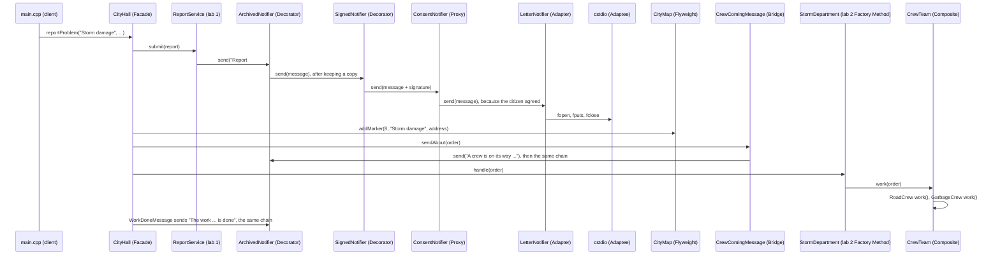
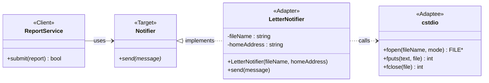
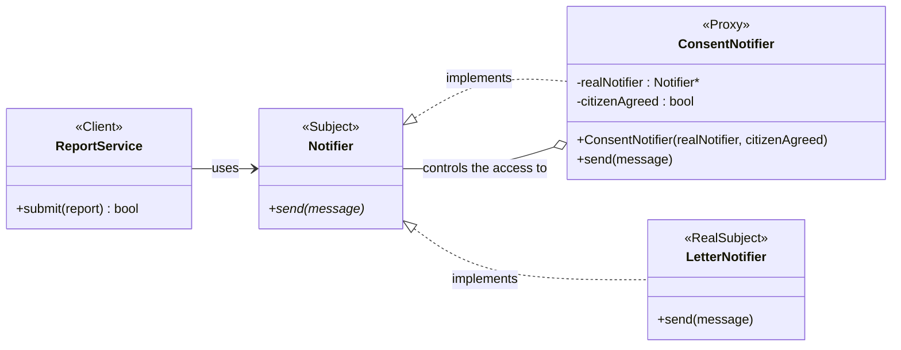
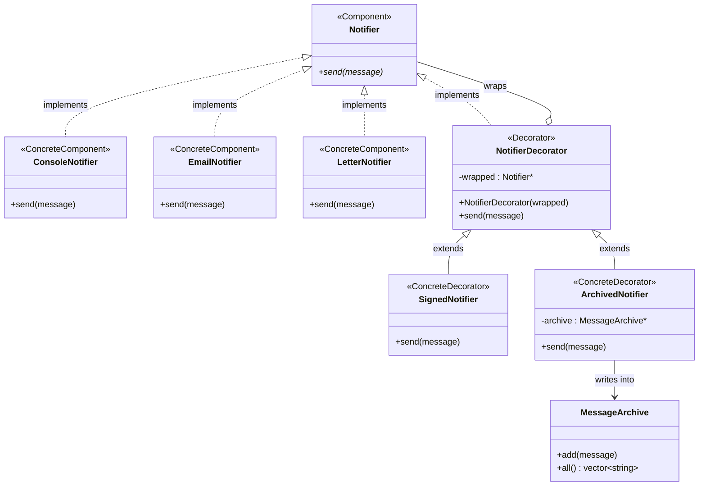
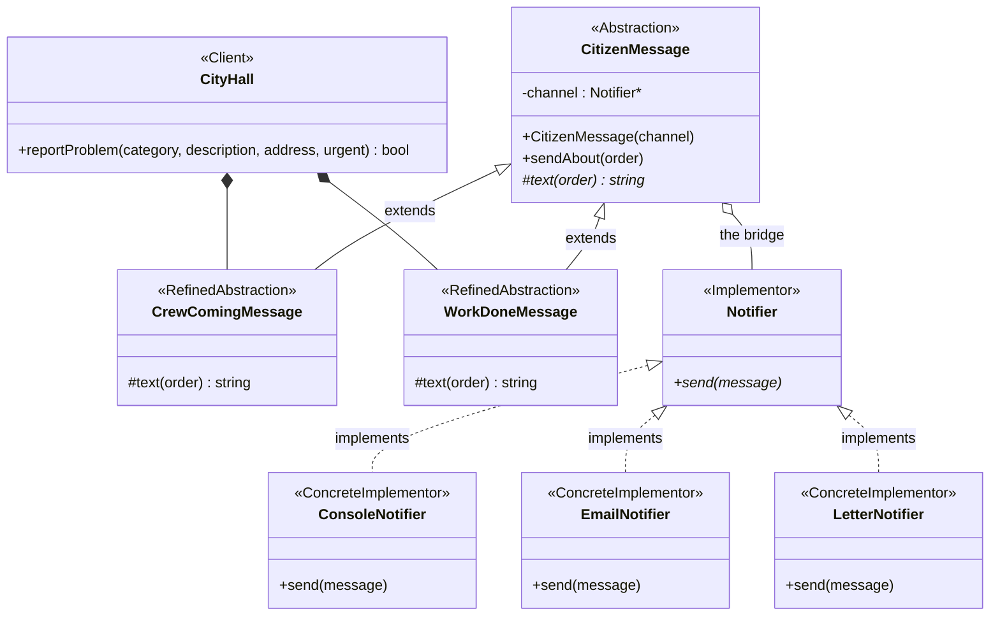
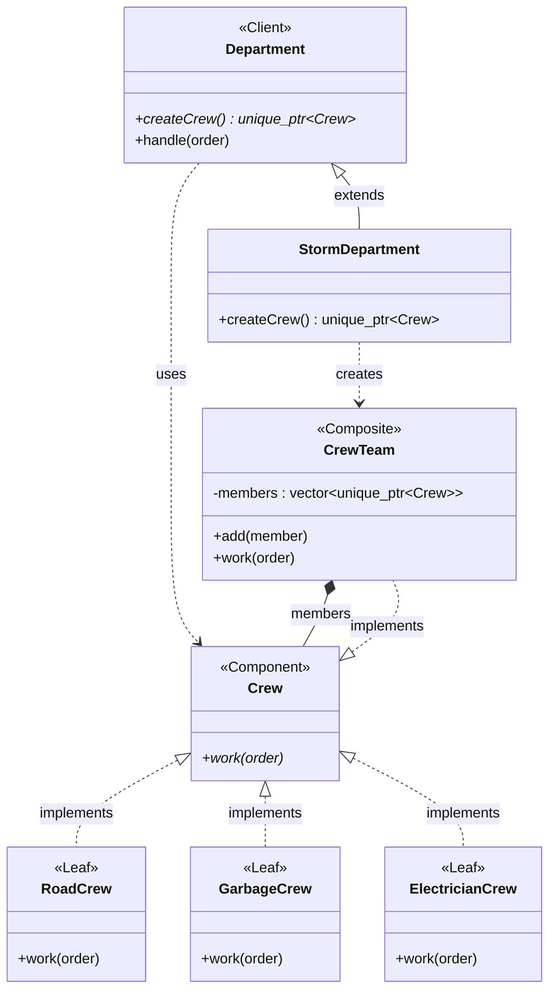
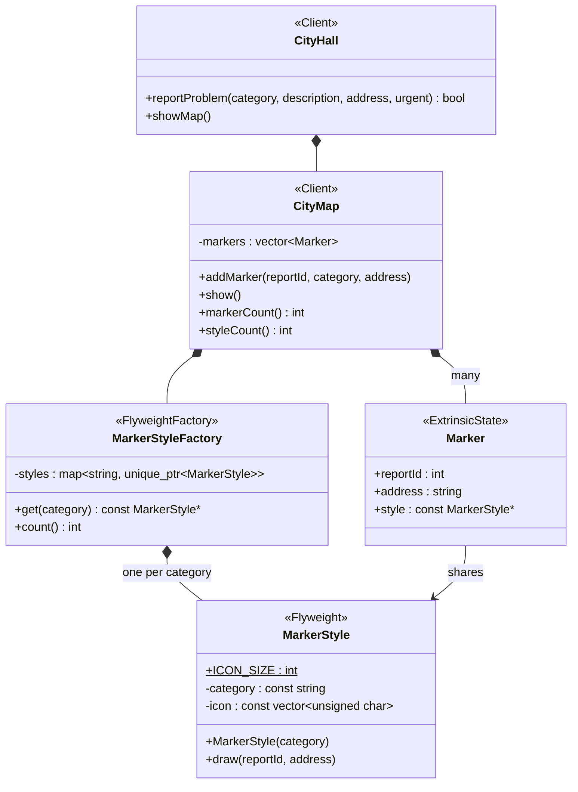
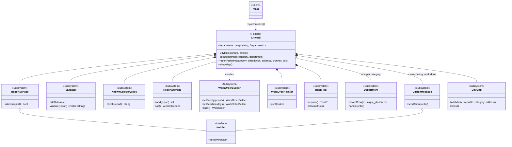

# Laboratory work 3 — Structural design patterns

**Author:** Eftode Andrei, FAF-242


## Objectives

- Explain the intent of each structural pattern and the problem it solves.
- Recognize where a structural pattern fits naturally in a codebase, and where it would be forced.
- Implement the patterns so that client code depends on abstractions, not concrete classes.
- Show that the design is open to extension: new variants can be added without modifying existing classes.
- Defend the design choices and adapt the code to a new requirement during the defense.

## Used design patterns

The task asks for at least 3 of the 7 structural patterns. This project uses all 7, and all
of them are on the path of one call to city hall:

- **Adapter**: `LetterNotifier` adapts the C standard library (`fopen`, `fputs`, `fclose`)
- **Proxy**: `ConsentNotifier`
- **Decorator**: `NotifierDecorator`, `SignedNotifier`, `ArchivedNotifier`
- **Bridge**: `CitizenMessage`, `CrewComingMessage`, `WorkDoneMessage` on one side, `Notifier` on the other
- **Composite**: `CrewTeam`, made by `StormDepartment`
- **Flyweight**: `MarkerStyle`, `MarkerStyleFactory`, `CityMap`
- **Facade**: `CityHall`

## 1. Domain description

The application is the backend of a city hall. Citizens report problems in the city (a
pothole, a broken street light, full garbage bins). City hall checks each report, saves it
and tells the citizen what happened. Then it makes a work order and sends the right crew
with a truck. There is no graphical interface: the program runs in the console.

The project grows lab by lab. Lab 1 made the reports, the rules that check them, the storage
and the `Notifier` interface (how the citizen is told). Lab 2 added the creational patterns:
the settings (Singleton), the work orders (Builder), the departments that make their crews
(Factory Method) and the trucks (Object Pool). Lab 3 adds seven things the system needs:

- citizens with no phone and no e-mail get a **paper letter**, written with a library the
  project did not write (Adapter);
- a letter goes out only if the citizen **agreed** to get letters (Proxy);
- every message city hall sends is **signed**, and city hall keeps a **copy** of it (Decorator);
- city hall tells the citizen when the **crew is on its way** and when the **work is done**,
  through whatever channel the citizen has (Bridge);
- after a storm, a **team** of crews goes out, sent the same way as one crew (Composite);
- every accepted report goes on a **city map**, where thousands of markers share one icon per
  category (Flyweight);
- the whole path of a report, from the citizen to the crew, is **one call** to city hall (Facade).

The classes of lab 1 and lab 2 were not changed. Lab 3 only adds classes.

The folders are named after what the code does in the city. The domain models are the data
classes: `Report` (lab 1, `reports/`), `WorkOrder` (lab 2, `workorders/`), `Truck` (lab 2,
`fleet/`) and `Marker` (lab 3, `map/`). The client code is `main.cpp`, and the tests are in
`tests/`.

| Folder | What is in it |
| --- | --- |
| [notifications/](notifications/) | new ways to tell the citizen and the extras around them: `LetterNotifier`, `ConsentNotifier`, `NotifierDecorator`, `SignedNotifier`, `ArchivedNotifier`, `MessageArchive` |
| [messages/](messages/) | what city hall tells the citizen about a work order: `CitizenMessage`, `CrewComingMessage`, `WorkDoneMessage` |
| [crews/](crews/) | a team of crews: `CrewTeam` |
| [departments/](departments/) | the department that sends a team: `StormDepartment` |
| [map/](map/) | the city map: `CityMap`, `Marker`, `MarkerStyle`, `MarkerStyleFactory` |
| [validation/](validation/) | the rule that knows the categories from the departments: `KnownCategoryRule` |
| [services/](services/) | one entry point for the whole system: `CityHall` |
| [../tests/Lab3Tests.cpp](../tests/Lab3Tests.cpp) | the unit tests |
| [../main.cpp](../main.cpp) | the client: `runLab3()` (menu option 5) and `runLab3Input()` (option 6) |

### How the patterns work together

All seven patterns are on one execution path. When the client reports storm damage, the call
goes through the facade. Every message to the citizen goes through both decorators, the proxy
and the adapter, and ends in the C library. The report goes on the map (flyweight), the bridge
messages tell the citizen about the crew, and the department sends a team (composite):



`ReportService` and the messages only know the `Notifier` interface, and `CityHall` only gets
a `Notifier*`, so none of them knows that the message is archived, signed, checked for consent
and written on paper. The client chooses that when it builds the objects in `main.cpp` (these
lines are from `runLab3()`, put together):

```cpp
LetterNotifier letters("letters.txt", "Ion Popescu, 15 Dacia Blvd.");
ConsentNotifier lettersToIon(&letters, true);
MessageArchive archive;
SignedNotifier signedLetters(&lettersToIon);
ArchivedNotifier archivedLetters(&signedLetters, &archive);
CityHall cityHall(&storage, &archivedLetters);
cityHall.addDepartment("Storm damage", &stormDepartment);
```

## 2. Adapter

> It lets classes work together, that couldn't otherwise because of incompatible parent
> classes. Aka Wrapper. *(slides)*

**The problem.** Some citizens have no phone and no e-mail, so city hall has to send them a
paper letter. The letters are written into a text file that the post office prints. Writing
a file is done with the C standard library (`<cstdio>`). The project did not write it and
can't change it, and its interface does not match the `Notifier` interface that
`ReportService` and `CityHall` use:

| `Notifier` (what the project expects) | `<cstdio>` (what the library gives) |
| --- | --- |
| one call: `send(message)` | three calls in order: `fopen`, `fputs`, `fclose` |
| takes a `std::string` | takes C-style text, `const char*` |
| nothing to open or close | works with a `FILE*` that must be opened and closed |
| knows only the message | needs a file name, and a letter needs the home address |
| shows its own errors | answers with error codes: `nullptr` from `fopen`, `EOF` from `fputs` |

### Class diagram



### Code

[notifications/LetterNotifier.cpp](notifications/LetterNotifier.cpp)

```cpp
void LetterNotifier::send(const string& message) {
    // Notifier has one call, and the C library needs three: open the file, write, close it.
    // "a" opens the file for adding at the end, so the letters written before are kept.
    FILE* file = fopen(fileName.c_str(), "a");

    // The C library does not tell anyone when it fails, it returns nullptr, so the adapter checks it.
    if (file == nullptr) {
        cout << "[letter] The letter could not be written: " << fileName << " can't be opened.\n";
        return;
    }

    // Notifier gives a std::string, and fputs wants C-style text, so the adapter converts it.
    string letter = "To: " + homeAddress + "\n" + message + "\n\n";
    if (fputs(letter.c_str(), file) == EOF) {
        cout << "[letter] The letter could not be written to " << fileName << ".\n";
    } else {
        cout << "[letter to " << homeAddress << "] " << message << "\n";
    }

    fclose(file);
}
```

`LetterNotifier` **is** a `Notifier`, so `ReportService` and `CityHall` use it like any other
notifier. Inside `send()` it translates the one call into the three calls of the C library,
turns `std::string` into C-style text with `c_str()` and turns the error codes into messages.

This is an object adapter: the adapter implements the target and uses the adaptee from
inside. A class adapter would inherit from the adaptee too, but the C library has no class
to inherit from.

### Unit tests

| Test | What it checks |
| --- | --- |
| `testLetterIsWrittenToTheFile` | one `send()`, called through a `Notifier*`, writes the home address and the message into the file through the C library |
| `testLettersAreAddedAtTheEnd` | a second letter goes after the first one and does not overwrite it (`fopen` with `"a"`) |
| `testFileThatCannotBeOpenedIsReported` | when `fopen` returns `nullptr`, the program does not crash and the adapter says the letter could not be written |

```
--- Adapter ---
[PASS] Adapter: send() puts the home address and the message into the file through the C library
[PASS] Adapter: a second letter is added after the first one, not written over it
[PASS] Adapter: when fopen returns nullptr, the adapter says the letter could not be written
```

## 3. Proxy

> An object representing another object. Control the access to an object by wrapping it into
> another. *(slides)*

**The problem.** Some citizens don't want to get letters, and city hall has to respect that.
`ReportService` (lab 1) and `CityHall` send messages in many places, and they should not
check the consent before each one, because then every class that sends a message would have
to know about consent. `ConsentNotifier` stands in front of the real notifier, with the same
`send()`, and controls the access to it: with the citizen's consent the message goes on
exactly as it came; without it, the real notifier is never called.

### Class diagram



### Code

[notifications/ConsentNotifier.cpp](notifications/ConsentNotifier.cpp)

```cpp
ConsentNotifier::ConsentNotifier(Notifier* realNotifier, bool citizenAgreed) {
    this->realNotifier = realNotifier;
    this->citizenAgreed = citizenAgreed;
}

void ConsentNotifier::send(const string& message) {
    // The access check comes first. Without consent, the real notifier is never called.
    if (!citizenAgreed) {
        cout << "[consent] The citizen did not agree to get messages this way, so this one is not sent.\n";
        return;
    }

    // With consent, the call goes on unchanged: the same message, to the same send().
    realNotifier->send(message);
}
```

The proxy has the same interface as the real notifier, so the client can't tell them apart,
and its `send()` checks the access before it delegates. When it lets the call through, it
passes the message on without changing it.

A proxy and a decorator both hold a `Notifier` and have the same `send()`, but they do a
different job. A decorator always passes the call on and **adds** something to it (the
signature, the copy). The proxy **decides whether** the call reaches the real object at all,
and it does not change the message.

### Unit tests

| Test | What it checks |
| --- | --- |
| `testProxyPassesTheMessageUnchangedWithConsent` | with consent, the real notifier (a stub that records the messages) gets exactly the message that was sent through the `Notifier*` |
| `testProxyBlocksTheMessageWithoutConsent` | without consent, the real notifier is never called, and the screen says why |
| `testProxyStopsTheLetterBeforeTheCLibrary` | the proxy works inside the decorators too: a signed letter without consent never reaches `fopen`, so no file is written |

```
--- Proxy ---
[PASS] Proxy: with consent, the real notifier gets the message exactly as it was sent
[PASS] Proxy: without consent, the real notifier is never called, and the screen says why
[PASS] Proxy: inside the decorators, a refused letter never reaches fopen, so no file is written
```

## 4. Decorator

> Add responsibilities to objects dynamically. Wrap the plain object into a specific
> decorator. *(slides)*

**The problem.** City hall wants two extras for every message: a signature, so the citizen
knows it really comes from city hall, and a copy of every message, so city hall can see
later what it told the citizens. With subclasses, every mix would need its own class:
`SignedEmailNotifier`, `SignedLetterNotifier`, `ArchivedSignedLetterNotifier`, and so on.
With three channels and two extras that is already many classes, and every new channel or
extra multiplies them. A decorator adds one extra and can be put around any notifier, while
the program runs.

### Class diagram



### Code

[notifications/NotifierDecorator.cpp](notifications/NotifierDecorator.cpp),
[notifications/SignedNotifier.cpp](notifications/SignedNotifier.cpp),
[notifications/ArchivedNotifier.cpp](notifications/ArchivedNotifier.cpp)

```cpp
NotifierDecorator::NotifierDecorator(Notifier* wrapped) {
    this->wrapped = wrapped;
}

void NotifierDecorator::send(const string& message) {
    wrapped->send(message);
}

void SignedNotifier::send(const string& message) {
    // The added part: the signature. Sending the message is still the wrapped notifier's job.
    NotifierDecorator::send(message + " -- Chisinau City Hall");
}

void ArchivedNotifier::send(const string& message) {
    // The added part: the copy. Sending the message is still the wrapped notifier's job.
    archive->add(message);
    NotifierDecorator::send(message);
}
```

The decorator is a `Notifier` and also keeps a `Notifier` inside it. Each concrete decorator
does its small job and then calls `NotifierDecorator::send()`, which passes the message to the
wrapped notifier, so decorators can be put one inside another, in any order.

Every decorator has only the `send()` of `Notifier`, and no methods of its own. The copies go
into a `MessageArchive` that `main.cpp` makes and gives to `ArchivedNotifier`, so whoever reads
the archive does not need the concrete decorator.

The order matters. `ArchivedNotifier` outside `SignedNotifier` keeps the text before the
signature is added; the other way around, it keeps the signed text. The citizen gets the
signed message in both cases. In the demo the archive is also outside the proxy, so it keeps
every message city hall wrote, even the ones the proxy did not let through.

### Unit tests

| Test | What it checks |
| --- | --- |
| `testSignatureIsAdded` | `SignedNotifier` adds the signature and passes the message to the wrapped notifier (a stub that only records the messages) |
| `testDecoratorsWorkInAnyOrder` | archive outside the signature and signature outside the archive: in both orders the citizen gets the signed message, and the order decides what the archive keeps |
| `testDecoratorWrapsTheAdapter` | the signature also works around `LetterNotifier`, so the letter in the file is signed, and `LetterNotifier` was not changed |

```
--- Decorator ---
[PASS] Decorator: SignedNotifier adds the signature and passes the message to the wrapped notifier
[PASS] Decorator: in both orders the citizen gets the signed message
[PASS] Decorator: the order of the decorators decides what the archive keeps
[PASS] Decorator: the signature also works around the letter adapter, without changing it
```

## 5. Bridge

> Separates an object's abstraction from its implementation so that these two levels could
> vary independently. Use it when you have 2 orthogonal dimensions. *(slides)*

**The problem.** City hall tells the citizen different things about a work order: a crew is
on its way, and the work is done. It also has different channels: the console, e-mail and
letters, with or without the decorators. These are two dimensions that change on their own:
a new kind of message must work with every channel, and a new channel with every message.
With one class for every mix (`EmailCrewComingMessage`, `LetterWorkDoneMessage`, ...) there
would be 2 × 3 = 6 classes now, and every new message or channel would add a whole row of
them. With the bridge there are 2 + 3 classes, and a new one on either side is one class.

### Class diagram



### Code

[messages/CitizenMessage.h](messages/CitizenMessage.h),
[messages/CitizenMessage.cpp](messages/CitizenMessage.cpp),
[messages/CrewComingMessage.cpp](messages/CrewComingMessage.cpp) (the comments are left out here)

```cpp
class CitizenMessage {
public:
    explicit CitizenMessage(Notifier* channel);
    virtual ~CitizenMessage() = default;

    void sendAbout(const WorkOrder& order);

protected:
    virtual std::string text(const WorkOrder& order) const = 0;

private:
    Notifier* channel;
};

void CitizenMessage::sendAbout(const WorkOrder& order) {
    channel->send(text(order));
}

string CrewComingMessage::text(const WorkOrder& order) const {
    return "A crew is on its way to " + order.address + ". The work will be done within "
           + to_string(order.deadlineDays) + " days.";
}
```

`CitizenMessage` keeps a `Notifier*`: that pointer is the bridge between the two hierarchies.
Each kind of message writes only its own `text()`, and `sendAbout()` gives the text to whatever
channel the message was given, so the two sides never know each other's subclasses.

The implementation side is the `Notifier` hierarchy of lab 1, so every notifier of lab 1 and
lab 3 (with its decorators and the proxy) is a channel for every message.

### Unit tests

| Test | What it checks |
| --- | --- |
| `testOneMessageTravelsThroughTwoChannels` | the same `WorkDoneMessage` goes through `ConsoleNotifier` and through `EmailNotifier`, with the same text |
| `testTwoMessagesUseTheSameChannel` | `CrewComingMessage` and `WorkDoneMessage` use the same channel, and each one sends its own text |
| `testCityHallTellsTheCitizenAtEveryStep` | city hall sends three messages in order: the report was registered, the crew is on its way, the work is done |

```
--- Bridge ---
[PASS] Bridge: the same kind of message travels through two different channels
[PASS] Bridge: two kinds of message use the same channel, each one with its own text
[PASS] Bridge: city hall tells the citizen: registered, then crew on its way, then work done
```

## 6. Composite

> A tree structure of simple and complex objects. It lets clients treat simple and complex
> objects uniformly. *(slides)*

**The problem.** In lab 2 every department sends one crew. After a storm, one street needs
two crews: the road crew for the holes and the garbage crew for the branches and the trash.
`Department::handle()` from lab 2 works with one `Crew`, and it should not change. If a team
were a different kind of object, every place that sends a crew would have to check whether
it got one crew or a team. `CrewTeam` is a `Crew` made of other crews, so a team is sent
exactly like one crew, and a team can even have another team inside it.

### Class diagram



### Code

[crews/CrewTeam.cpp](crews/CrewTeam.cpp),
[departments/StormDepartment.cpp](departments/StormDepartment.cpp)

```cpp
void CrewTeam::add(unique_ptr<Crew> member) {
    // A unique_ptr can't be copied, only moved, so the team becomes the only owner of the crew.
    members.push_back(move(member));
}

void CrewTeam::work(const WorkOrder& order) const {
    cout << "a team of " << members.size() << " crews goes out:\n";

    // The team does not do the job itself and never asks what kind of crew a member is. It calls
    // work() on each member, and a member that is a team does the same with its own crews.
    for (const unique_ptr<Crew>& member : members) {
        cout << "  - ";
        member->work(order);
    }
}

unique_ptr<Crew> StormDepartment::createCrew() const {
    unique_ptr<CrewTeam> team = make_unique<CrewTeam>();
    team->add(make_unique<RoadCrew>());
    team->add(make_unique<GarbageCrew>());
    return team;
}
```

The leaves and the team have the same interface, `Crew`, and the team's `work()` only calls
`work()` on its members. Because of that, `Department::handle()` from lab 2 sends a team
without a single change, and nobody checks the type of a crew.

`StormDepartment` is a new Concrete Creator of the Factory Method from lab 2, so the
creational pattern makes the object the structural pattern works with.

### Unit tests

| Test | What it checks |
| --- | --- |
| `testTeamAndSingleCrewUseTheSameInterface` | one `RoadCrew` and a team of two crews are given to the same function, which takes a `const Crew&`; both do their work |
| `testTeamInsideATeam` | a team that has the electricians and another team inside it: every crew in the tree does its job |
| `testStormDepartmentSendsATeamThroughCityHall` | a "Storm damage" report through city hall: the storm department's team goes out, the road crew first and then the garbage crew |

```
--- Composite ---
[PASS] Composite: one crew and a team are used through the same Crew interface
[PASS] Composite: a team inside a team works too, every crew in the tree does its job
[PASS] Composite: city hall sends the storm team the same way it sends one crew
```

## 7. Flyweight

> Use sharing to support large numbers of fine grained objects efficiently. Intrinsic: state
> independent part. Extrinsic: state dependent part. *(slides)*

**The problem.** City hall shows every accepted report on a map of the city. A marker on the
map has an icon: a picture of 32 × 32 pixels, 4 bytes per pixel, so 4096 bytes. City hall gets
thousands of reports a year, and if every marker kept its own copy of the icon, a year of
reports would need about 40 MB just for icons, even though all the potholes look the same.
The icon depends only on the category, so it can be shared. The flyweight splits a marker in
two:

| Intrinsic state (shared, in `MarkerStyle`) | Extrinsic state (one per marker, in `Marker`) |
| --- | --- |
| the category and its icon | the report number and the address |
| the same for every marker of the category | different for every marker |
| `const`, set once in the constructor | given to `draw()` when the marker is drawn |

### Class diagram



### Code

[map/MarkerStyleFactory.cpp](map/MarkerStyleFactory.cpp),
[map/CityMap.cpp](map/CityMap.cpp)

```cpp
const MarkerStyle* MarkerStyleFactory::get(const string& category) {
    // Look it up, or make it: a new style is made only the first time a category is asked for.
    if (styles.count(category) == 0) {
        styles[category] = make_unique<MarkerStyle>(category);
    }
    return styles[category].get();
}

void CityMap::addMarker(int reportId, const string& category, const string& address) {
    Marker marker;
    marker.reportId = reportId;
    marker.address = address;
    marker.style = styles.get(category);  // the same style for every marker of the category
    markers.push_back(marker);
}

void CityMap::show() const {
    cout << "The city map, " << markers.size() << " marker(s):\n";
    for (const Marker& marker : markers) {
        // The style is shared, so the marker gives it the part that is only its own.
        marker.style->draw(marker.reportId, marker.address);
    }
}
```

The factory's `get()` looks up the style of a category and makes it only the first time, so
every marker of a category points to the same `MarkerStyle`. The marker keeps only its own
data and passes it to `draw()`, so nothing that belongs to one marker is kept in the shared
style.

The fields of `MarkerStyle` are `const` and private, and it has no setters, so the shared
state can't be changed by one marker behind the others' back.

**Measurement.** The demo and the tests put a year of reports on the map, 10000 markers in 4
categories:

| | Styles in memory | Memory for the icons |
| --- | --- | --- |
| every marker with its own icon | 10000 | 10000 × 4096 bytes = 40000 KB |
| with the flyweight | 4 | 4 × 4096 bytes = 16 KB |

The console can't show pictures, so here an icon is 4096 bytes of zeros, the memory a real
icon would take. A real map would load the picture from a file in the constructor of
`MarkerStyle`, which is also the place where the demo prints `The icon of "..." was loaded`:
it is printed 4 times for 10000 markers.

### Unit tests

| Test | What it checks |
| --- | --- |
| `testSameCategoryGivesTheSameStyle` | two requests for "Pothole" return the same object (the same address in memory), and "Garbage" gets a different one |
| `testManyMarkersShareFewStyles` | 10000 markers in 4 categories make only 4 styles, each icon is loaded once, and the icons take 16 KB instead of 40000 KB |
| `testAddressStaysOutsideTheStyle` | one shared style draws two markers at two different addresses, so the address is not kept inside it |
| `testCityHallPutsEveryAcceptedReportOnTheMap` | city hall puts an accepted report on its map, and not a refused one |

```
--- Flyweight ---
[PASS] Flyweight: two requests for the same category return the same instance
[PASS] Flyweight: 10000 markers in 4 categories make only 4 styles, each icon is loaded once
[PASS] Flyweight: the icons take 16 KB instead of 40000 KB
[PASS] Flyweight: one shared style draws two markers at two addresses, it does not keep them
[PASS] Flyweight: city hall puts the accepted report on its map, and not the refused one
```

## 8. Facade

> Provides a unified interface that represents multiple components. Wraps a complex
> sub-system with a simple abstraction. *(slides)*

**The problem.** After lab 2, handling one report needed many classes, used in the right
order: the rules and the `Validator`, `ReportService`, the `ReportStorage`, the
`WorkOrderBuilder` and its printer, the `TruckPool` and the right department. Lab 3 adds the
map and the messages about the crew. The client had to know all of them, and in lab 2
`runLab2Input()` really does every step by hand. The lab task also asks that the creational
patterns are used inside the functionalities, not in the client. `CityHall` keeps the parts
of the system inside it and gives the client one method, `reportProblem()`.

### Class diagram



`*--` means city hall makes the part itself and keeps it inside, `o--` means it gets the part
from outside and only points to it, and `..>` means it only uses the class inside a method.

### Code

[services/CityHall.cpp](services/CityHall.cpp) (the comments are left out here)

```cpp
bool CityHall::reportProblem(const string& category, const string& description,
                             const string& address, bool urgent) {
    if (!reportService.submit(Report(category, description))) {
        return false;
    }
    vector<Report> reports = storage->all();
    const Report& report = reports.back();

    WorkOrderBuilder builder(report, address);
    if (urgent) {
        builder.setPriority("High").setDeadline(2);
    }
    WorkOrder order = builder.build();
    orderPrinter.print(order);

    cityMap.addMarker(report.id, category, address);

    Truck* truck = trucks.acquire();
    if (truck == nullptr) {
        cout << "No truck is free, so the work order waits.\n";
        return true;
    }
    crewComingMessage.sendAbout(order);
    cout << "Truck #" << truck->number << " goes out. ";
    departments[category]->handle(order);
    trucks.release(truck);
    workDoneMessage.sendAbout(order);
    return true;
}
```

The facade does not do the work itself: every step is one call to a class of the subsystem
(lab 1's service, the Builder, the map, the Object Pool, the messages, the Factory Method of
the department). The client now needs only `cityHall.reportProblem("Pothole", "Deep pothole
in front of the hospital", "Ismail St. 40", true)`.

The only thing the facade decides itself is what "urgent" means for the work order (a high
priority and 2 days). Everything else is delegated.

The facade is open for extension. The client tells city hall which department takes care of
which category, and `KnownCategoryRule` accepts every category that has a department, so a
new category is a new department class and one more line in the client. Neither `CityHall`
nor the lists of lab 1 change. "Storm damage" was added exactly like this:

```cpp
RoadDepartment roads;
LightingDepartment lighting;
SanitationDepartment sanitation;
cityHall.addDepartment("Pothole", &roads);
cityHall.addDepartment("Street light", &lighting);
cityHall.addDepartment("Garbage", &sanitation);
cityHall.addDepartment("Storm damage", &stormDepartment);
```

The subsystem is not hidden completely: its classes are still public, so code that needs
something special can still use them directly.

### Unit tests

| Test | What it checks |
| --- | --- |
| `testAcceptedReportGoesThroughEveryStepInOrder` | one call saves the report, and the steps run in the right order: the citizen is told, then the work order is made, then a truck goes out, then the crew works |
| `testRefusedReportGetsNoWorkOrder` | a refused report is not saved and gets no work order, and the citizen is told why (checked with the recording stub) |
| `testEachCategoryGoesToItsDepartment` | the department given with `addDepartment()` for a category is the one that sends its crew |
| `testNewDepartmentMakesItsCategoryKnown` | a category without a department is refused with a message; after `addDepartment()` the same report is accepted, and `CityHall` did not change |

The order is checked on the text the subsystem writes on the screen: the test sends `cout`
into a string for a moment and checks that each step's line comes before the next one.

```
--- Facade ---
[PASS] Facade: one call to reportProblem() saves the report
[PASS] Facade: the steps run in the right order: citizen told, work order, truck, crew
[PASS] Facade: a refused report is not saved and gets no work order
[PASS] Facade: the citizen is told why the report was refused
[PASS] Facade: the department added for the category is the one that sends its crew
[PASS] Facade: a category with no department is refused, and the citizen is told why
[PASS] Facade: after addDepartment() the same category is accepted, and CityHall did not change
```

## 9. How the requirements are met

| Requirement from the lab sheet | Where |
| --- | --- |
| At least three structural patterns, each with its full structure | all seven. Adapter: target, adapter, adaptee. Proxy: subject, proxy, real subject. Decorator: component, three concrete components, base decorator, two concrete decorators. Bridge: abstraction, two refined abstractions, implementor, three concrete implementors. Composite: component, four leaves, composite. Flyweight: flyweight, flyweight factory, client, extrinsic state. Facade: facade and its subsystem |
| The patterns interact | one `reportProblem()` call goes through all seven (the sequence diagram in section 1) |
| The client depends on abstractions | `ReportService`, `CityHall` and the messages know only `Notifier*`; `CityHall` knows only `Department*`; `Department::handle()` knows only `Crew`; a marker knows only its `MarkerStyle` |
| Open for extension | a new channel is a new `Notifier`, a new extra is a new `NotifierDecorator`, a new message is a new `CitizenMessage`, a new team is a new department that builds a `CrewTeam`, a new category is a new department and one `addDepartment()` line; no existing class changes |
| Build on the creational lab | `CityHall` uses the Builder, the Factory Method, the Object Pool and the Singleton (`AppConfig`) from lab 2, and `StormDepartment` is a new Concrete Creator of the Factory Method that makes the Composite |
| Clean structure | the domain models (`Report`, `WorkOrder`, `Truck`, `Marker`), the pattern classes in the lab 3 folders named after what they do, the client in `main.cpp`, the tests in `tests/` |
| Runnable demo | menu option 5 (ready example, one section per pattern) and option 6 (your own reports) |
| Adapt a library you cannot change | the C standard library (`<cstdio>`) |
| At least 2 unit tests per pattern | 28 tests in [../tests/Lab3Tests.cpp](../tests/Lab3Tests.cpp), 3 to 7 per pattern, they run with one command |
| Measurements where applicable | the flyweight: 4 styles and 16 KB of icons for 10000 markers, instead of 40000 KB |

The lab sheet lists the mistakes that lose points. This is how the project avoids each one:

| Pattern | Mistake from the lab sheet | In this project |
| --- | --- | --- |
| Adapter | adapting a class you wrote yourself | the adaptee is the C standard library, which the project can't change |
| Bridge | only one implementation on one side | two messages on one side and three channels (plus their decorators) on the other |
| Composite | leaf and group with different interfaces, so the client checks the types | a crew and a team are both `Crew`; `Department::handle()` never checks the type |
| Decorator | a subclass with extra methods; decorators can't be stacked at runtime | the decorators have only `send()`, and they are stacked in any order in `main.cpp` and in the tests |
| Facade | a god class with business logic instead of delegating | each step of `reportProblem()` is one call to a class of the subsystem |
| Flyweight | mutable intrinsic state, or extrinsic state kept in the flyweight | `MarkerStyle` has only `const` fields; the report number and the address stay in `Marker` and are passed to `draw()` |
| Proxy | changing the interface of the real object | `ConsentNotifier` is a `Notifier` with the same `send()`, and it passes the message on unchanged |
| Any | isolated demos; tutorial code with renamed classes | all seven work on one call, and every class comes from this city hall project |

How to build, run and test is in [README.md](README.md).

## 10. Where each pattern fits, and where it would be forced

The task asks to recognize where a pattern fits naturally and where it would be forced.

| Pattern | Why it fits here | When it would be forced |
| --- | --- | --- |
| Adapter | the C library really has a different interface (three calls, C text, error codes) | for a class of the project itself: then it is simpler to change the class |
| Proxy | the consent is checked in one place, and no class that sends messages has to know about it | if every message went to the same citizen who always agreed: there would be nothing to control |
| Decorator | the extras (signature, copy) mix with every channel, in any order | with one channel and one extra, a decorator is one class more than needed |
| Bridge | two kinds of messages and several channels change on their own | with only one message or only one channel there is nothing to separate |
| Composite | a team and one crew are sent in the same way, and teams can have teams inside | if every job always needed exactly one crew |
| Flyweight | thousands of markers share four icons, and the measurement shows the memory saved | with a few markers, like the 3 on the small map of the demo, it saves almost nothing and only adds the factory |
| Facade | handling one report needs ten classes in the right order | with one or two steps, the facade would only pass calls on |

The Flyweight is the one that needs the most care: it pays off only because the map is meant
for a whole year of reports. For the few reports of one run of the demo, a plain marker with
its own style would be simpler.

## 11. Results

The ready example, menu option 5:

```
=== Laboratory work 3: Structural design patterns ===

--- 1. Adapter ---
ReportService from lab 1 gets a LetterNotifier, and its code stays the same:
[letter to Ion Popescu, 15 Dacia Blvd.] Report #1 was registered.
[letter to Ion Popescu, 15 Dacia Blvd.] Report refused: The description must have at least 10 characters.
A file that can't be opened makes fopen return nullptr, and the adapter says so:
[letter] The letter could not be written: no_such_folder/letters.txt can't be opened.

--- 2. Proxy ---
Ion agreed to get letters, so the proxy passes the message on unchanged:
[letter to Ion Popescu, 15 Dacia Blvd.] Report #2 was registered.
Maria did not agree, so the proxy stops the letter before it reaches the C library:
[consent] The citizen did not agree to get messages this way, so this one is not sent.

--- 3. Decorator ---
Ion's letters (through the proxy), wrapped so every message is signed and archived:
[letter to Ion Popescu, 15 Dacia Blvd.] Report #4 was registered. -- Chisinau City Hall
The same signature works on any notifier, for example on e-mail:
[e-mail] The street lights on Ion Creanga St. were repaired. -- Chisinau City Hall
The archive kept 1 message(s):
  - Report #4 was registered.

--- 4. Bridge ---
[config] The settings were loaded.
The same message, "the work is done", through two different channels:
[e-mail] The work at Puskin St. 22 is done. Thank you for report #4.
[letter to Ion Popescu, 15 Dacia Blvd.] The work at Puskin St. 22 is done. Thank you for report #4. -- Chisinau City Hall
Two different messages through the same channel:
[e-mail] A crew is on its way to Puskin St. 22. The work will be done within 7 days.
[e-mail] The work at Puskin St. 22 is done. Thank you for report #4.

--- 5. Composite ---
A department of lab 2 sends one crew:
Report #5 (High priority, 7 days): the road crew fills the pothole at Grenoble St. 120.
The storm department sends a team, through the same handle() of lab 2:
Report #5 (High priority, 7 days): a team of 2 crews goes out:
  - the road crew fills the pothole at Grenoble St. 120.
  - the garbage crew cleans up at Grenoble St. 120.
A team can have another team inside it, for a really big job:
a team of 2 crews goes out:
  - the electricians repair the street light at Grenoble St. 120.
  - a team of 2 crews goes out:
  - the road crew fills the pothole at Grenoble St. 120.
  - the garbage crew cleans up at Grenoble St. 120.

--- 6. Flyweight ---
Three markers, two of them potholes. The pothole icon is loaded only once:
[map] The icon of "Pothole" was loaded.
[map] The icon of "Garbage" was loaded.
The city map, 3 marker(s):
  [Pothole] report #101 at Ismail St. 40
  [Pothole] report #102 at Dacia Blvd. 5
  [Garbage] report #103 at Puskin St. 22
A year of reports: 10000 markers in 4 categories:
[map] The icon of "Pothole" was loaded.
[map] The icon of "Street light" was loaded.
[map] The icon of "Garbage" was loaded.
[map] The icon of "Storm damage" was loaded.
  10000 markers share 4 styles.
  The icons take 16 KB. If every marker kept its own icon,
  they would take 40000 KB.

--- 7. Facade ---
An urgent pothole, reported with one call:
[letter to Ion Popescu, 15 Dacia Blvd.] Report #6 was registered. -- Chisinau City Hall
Work order for report #6 (Pothole)
  address:  Ismail St. 40
  priority: High
  deadline: 2 days
[map] The icon of "Pothole" was loaded.
[letter to Ion Popescu, 15 Dacia Blvd.] A crew is on its way to Ismail St. 40. The work will be done within 2 days. -- Chisinau City Hall
Truck #1 goes out. Report #6 (High priority, 2 days): the road crew fills the pothole at Ismail St. 40.
[letter to Ion Popescu, 15 Dacia Blvd.] The work at Ismail St. 40 is done. Thank you for report #6. -- Chisinau City Hall

A broken street light that is not urgent:
[letter to Ion Popescu, 15 Dacia Blvd.] Report #7 was registered. -- Chisinau City Hall
Work order for report #7 (Street light)
  address:  Mihai Viteazul St. 7
  priority: Normal
  deadline: 7 days
[map] The icon of "Street light" was loaded.
[letter to Ion Popescu, 15 Dacia Blvd.] A crew is on its way to Mihai Viteazul St. 7. The work will be done within 7 days. -- Chisinau City Hall
Truck #1 goes out. Report #7 (Normal priority, 7 days): the electricians repair the street light at Mihai Viteazul St. 7.
[letter to Ion Popescu, 15 Dacia Blvd.] The work at Mihai Viteazul St. 7 is done. Thank you for report #7. -- Chisinau City Hall

Storm damage: a new category, and its department sends a team (Composite):
[letter to Ion Popescu, 15 Dacia Blvd.] Report #8 was registered. -- Chisinau City Hall
Work order for report #8 (Storm damage)
  address:  Grenoble St. 120
  priority: High
  deadline: 2 days
[map] The icon of "Storm damage" was loaded.
[letter to Ion Popescu, 15 Dacia Blvd.] A crew is on its way to Grenoble St. 120. The work will be done within 2 days. -- Chisinau City Hall
Truck #1 goes out. Report #8 (High priority, 2 days): a team of 2 crews goes out:
  - the road crew fills the pothole at Grenoble St. 120.
  - the garbage crew cleans up at Grenoble St. 120.
[letter to Ion Popescu, 15 Dacia Blvd.] The work at Grenoble St. 120 is done. Thank you for report #8. -- Chisinau City Hall

A report that is refused does not get a work order:
[letter to Ion Popescu, 15 Dacia Blvd.] Report refused: "Aliens" is not a known category. -- Chisinau City Hall
[letter to Ion Popescu, 15 Dacia Blvd.] Report refused: The description must have at least 10 characters. -- Chisinau City Hall

Every letter city hall sent in this example:
  - Report #4 was registered.
  - The work at Puskin St. 22 is done. Thank you for report #4.
  - Report #6 was registered.
  - A crew is on its way to Ismail St. 40. The work will be done within 2 days.
  - The work at Ismail St. 40 is done. Thank you for report #6.
  - Report #7 was registered.
  - A crew is on its way to Mihai Viteazul St. 7. The work will be done within 7 days.
  - The work at Mihai Viteazul St. 7 is done. Thank you for report #7.
  - Report #8 was registered.
  - A crew is on its way to Grenoble St. 120. The work will be done within 2 days.
  - The work at Grenoble St. 120 is done. Thank you for report #8.
  - Report refused: "Aliens" is not a known category.
  - Report refused: The description must have at least 10 characters.
The letters are in the file letters.txt, ready for the post office.

Every report city hall accepted is on its map:
The city map, 3 marker(s):
  [Pothole] report #6 at Ismail St. 40
  [Street light] report #7 at Mihai Viteazul St. 7
  [Storm damage] report #8 at Grenoble St. 120
```

Report #3 is Maria's: it was registered, but she got no letter, because she did not agree.
Report #5 was saved straight into the storage in the Composite section, to show only the
crews.

The letters written for the post office, in `letters.txt` (the first ones):

```
To: Ion Popescu, 15 Dacia Blvd.
Report #1 was registered.

To: Ion Popescu, 15 Dacia Blvd.
Report refused: The description must have at least 10 characters.

To: Ion Popescu, 15 Dacia Blvd.
Report #2 was registered.

To: Ion Popescu, 15 Dacia Blvd.
Report #4 was registered. -- Chisinau City Hall

To: Ion Popescu, 15 Dacia Blvd.
The work at Puskin St. 22 is done. Thank you for report #4. -- Chisinau City Hall

...
```

All the unit tests:

```
=== Unit tests of laboratory work 3: structural design patterns ===

--- Adapter ---
[PASS] Adapter: send() puts the home address and the message into the file through the C library
[PASS] Adapter: a second letter is added after the first one, not written over it
[PASS] Adapter: when fopen returns nullptr, the adapter says the letter could not be written

--- Proxy ---
[PASS] Proxy: with consent, the real notifier gets the message exactly as it was sent
[PASS] Proxy: without consent, the real notifier is never called, and the screen says why
[PASS] Proxy: inside the decorators, a refused letter never reaches fopen, so no file is written

--- Decorator ---
[PASS] Decorator: SignedNotifier adds the signature and passes the message to the wrapped notifier
[PASS] Decorator: in both orders the citizen gets the signed message
[PASS] Decorator: the order of the decorators decides what the archive keeps
[PASS] Decorator: the signature also works around the letter adapter, without changing it

--- Bridge ---
[PASS] Bridge: the same kind of message travels through two different channels
[PASS] Bridge: two kinds of message use the same channel, each one with its own text
[PASS] Bridge: city hall tells the citizen: registered, then crew on its way, then work done

--- Composite ---
[PASS] Composite: one crew and a team are used through the same Crew interface
[PASS] Composite: a team inside a team works too, every crew in the tree does its job
[PASS] Composite: city hall sends the storm team the same way it sends one crew

--- Flyweight ---
[PASS] Flyweight: two requests for the same category return the same instance
[PASS] Flyweight: 10000 markers in 4 categories make only 4 styles, each icon is loaded once
[PASS] Flyweight: the icons take 16 KB instead of 40000 KB
[PASS] Flyweight: one shared style draws two markers at two addresses, it does not keep them
[PASS] Flyweight: city hall puts the accepted report on its map, and not the refused one

--- Facade ---
[PASS] Facade: one call to reportProblem() saves the report
[PASS] Facade: the steps run in the right order: citizen told, work order, truck, crew
[PASS] Facade: a refused report is not saved and gets no work order
[PASS] Facade: the citizen is told why the report was refused
[PASS] Facade: the department added for the category is the one that sends its crew
[PASS] Facade: a category with no department is refused, and the citizen is told why
[PASS] Facade: after addDepartment() the same category is accepted, and CityHall did not change

28 tests, 28 passed, 0 failed.
```

## 12. Conclusions

The hardest part was the Adapter. My first version adapted an SMS gateway class that I had
written myself, so there was no real incompatibility: I had made the "foreign" interface
myself. A real adapter needs code I can't change. The C library's file functions are such
code: they have a different way of working (open, write, close), C-style text and error codes
instead of messages, and the adapter has to deal with all of that behind one `send()`.

The Proxy and the Decorator were harder to tell apart than I expected, because both hold a
`Notifier` and have the same `send()`. The difference is in what they are for: the decorators
always pass the message on and add something to it, while the proxy decides whether the
message reaches the real notifier at all and never changes it. The tests show exactly that.

The Flyweight was the hardest one to justify. With the few reports of one run it saves almost
nothing, so I measured it on a year of reports: 4 styles and 16 KB of icons instead of 40000
KB. The Composite needed `unique_ptr` and `move`, because a team owns its crews, and a team
inside a team owns its own crews too.

Testing was harder than I expected too. The decorators, the proxy and the bridge were easy to
test with a small stub that only remembers the messages. The facade was harder, because its
steps write on the screen instead of returning something, so the test has to catch the screen
output and check the order of the lines. I also saw that the order of the decorators changes
the result: the archive keeps the signed or the unsigned text depending on which decorator is
outside.

If I did it again, I would change three things. First, the facade and the classes of lab 2
write directly on the screen with `cout`. If they returned their results or used a printer
interface, the tests would be simpler and the same classes could work without a console.
Second, the consent is given when the proxy is made; a real system would read it from the
citizen's profile every time. Third, the facade still decides what "urgent" means for the
work order; a small priority rule given to city hall from outside would make it open for that
too.

## C++ used in the code

New things compared to lab 1 and lab 2:

| In the code | What it means |
| --- | --- |
| `#include <cstdio>` | the C standard library for files: `fopen`, `fputs`, `fclose`, `FILE`, `EOF` |
| `FILE* file = fopen(name, "a")` | opens a file and gives a pointer to it; `"a"` means "add at the end"; it returns `nullptr` if the file can't be opened |
| `fputs(text, file) == EOF` | writes C-style text into the file; `EOF` is the code it returns when it fails |
| `fclose(file)` | closes the file, so everything written is saved |
| `message.c_str()` | gives the text of a `std::string` as C-style text, so it can be passed to a C function |
| `SignedNotifier(Notifier* wrapped) : NotifierDecorator(wrapped) {}` | the constructor first calls the constructor of the base class and gives it `wrapped` |
| `NotifierDecorator::send(message)` | calls the method of the base class, not the one of the current class |
| `const vector<string>& all() const` | returns the list itself, not a copy, and the caller can only read it |
| `map<string, const Department*> departments` | a dictionary: for each category (the key) it keeps the department (the value) |
| `departments->count(report.category) == 0` | the category is not in the dictionary; `->` because `departments` is a pointer to the map |
| `departments[category]->handle(order)` | finds the department of the category and calls its method through the pointer |
| `: storage(storage), categoryRule(&departments), ...` | the initializer list makes the objects that `CityHall` keeps inside it, with their constructor arguments, in the order they are declared |
| `protected:` and `virtual std::string text(...) const = 0;` | only the class and its subclasses can use `text()`; each subclass must write its own |
| `std::vector<std::unique_ptr<Crew>> members` | a list of crews that the team owns: each crew is deleted when the team is deleted |
| `members.push_back(move(member))` | a `unique_ptr` can't be copied, only moved; after `move`, the team is the only owner |
| `return team;` (a `unique_ptr<CrewTeam>` returned as `unique_ptr<Crew>`) | a pointer to a child class turns into a pointer to the parent class by itself |
| `static const int ICON_SIZE = 32 * 32 * 4;` | one constant for the whole class, not one copy per object; used as `MarkerStyle::ICON_SIZE` |
| `const std::string category;` and `: category(category), icon(ICON_SIZE)` | a `const` field can only be set in the initializer list of the constructor, and never changed after |
| `std::vector<unsigned char> icon(4096)` | a list of 4096 bytes, all set to 0 |
| `std::map<std::string, std::unique_ptr<MarkerStyle>> styles` | a dictionary from the category to the style it owns |
| `styles[category].get()` | gives the plain pointer that is inside the `unique_ptr`; the map still owns the object |
| `const MarkerStyle*` | a pointer through which the object can be read but not changed |
| `string categories[] = {...};` and `categories[i % 4]` | an array; `%` is the remainder, so the index goes 0, 1, 2, 3, 0, 1, ... |
| `int reportId = 0;` in a `struct` | a field with a value it gets when nobody sets it |
| `cout.rdbuf(capturedScreen.rdbuf())` (tests) | for a moment, `cout` writes into a string instead of the screen, so a test can read what was printed |
