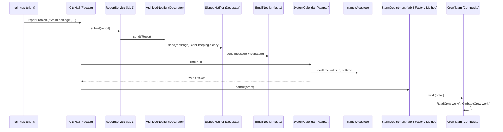
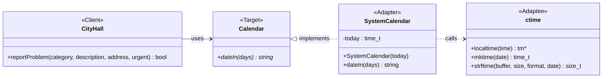
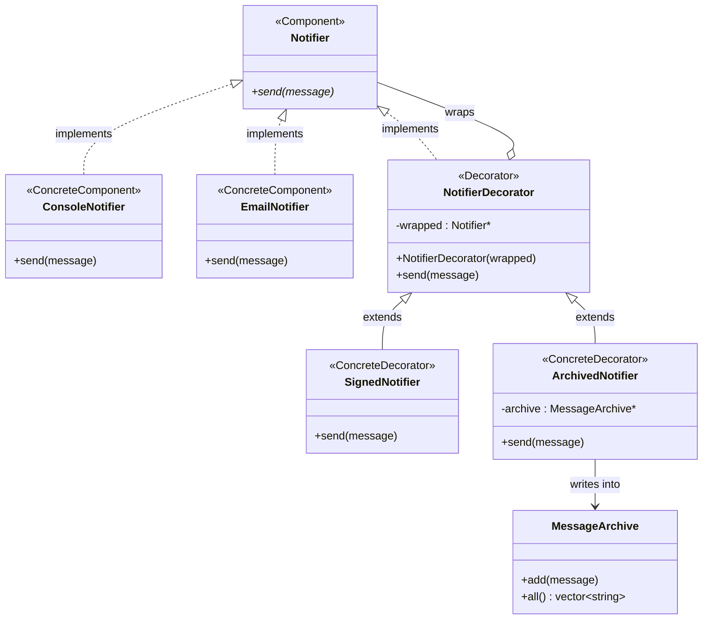
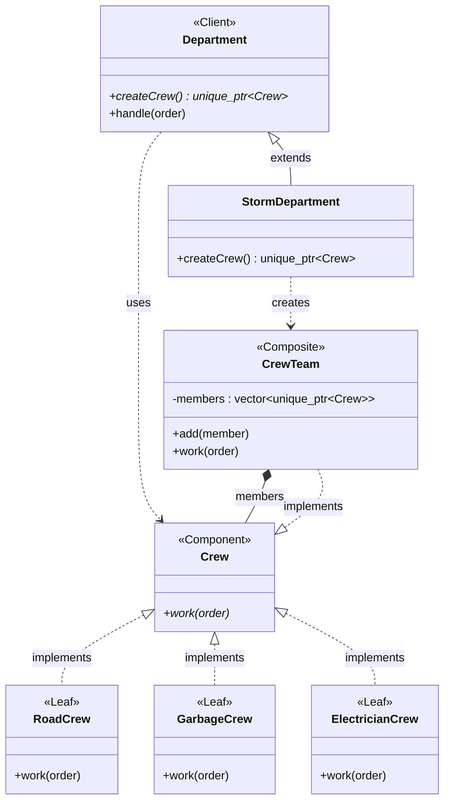
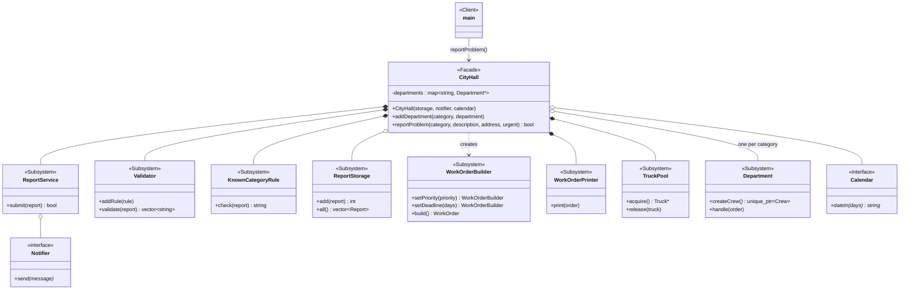

# Laboratory work 3 — Structural design patterns

**Author:** Eftode Andrei, FAF-242


## Objectives

- Explain the intent of each structural pattern and the problem it solves.
- Recognize where a structural pattern fits naturally in a codebase, and where it would be forced.
- Implement the patterns so that client code depends on abstractions, not concrete classes.
- Show that the design is open to extension: new variants can be added without modifying existing classes.
- Defend the design choices and adapt the code to a new requirement during the defense.

## Used design patterns

The task asks for at least 3 structural patterns. This project uses 4, and all of them are on
the path of one call to city hall:

- **Adapter**: `SystemCalendar` adapts the time functions of the C standard library (`<ctime>`) to `Calendar`
- **Decorator**: `NotifierDecorator`, `SignedNotifier`, `ArchivedNotifier`
- **Composite**: `CrewTeam`, made by `StormDepartment`
- **Facade**: `CityHall`

## 1. Domain description

The application is the backend of a city hall. Citizens report problems in the city (a
pothole, a broken street light, full garbage bins). City hall checks each report, saves it
and tells the citizen what happened. Then it makes a work order and sends the right crew
with a truck. There is no graphical interface: the program runs in the console.

The project grows lab by lab. Lab 1 made the reports, the rules that check them, the storage
and the `Notifier` interface (how the citizen is told). Lab 2 added the creational patterns:
the settings (Singleton), the work orders (Builder), the departments that make their crews
(Factory Method) and the trucks (Object Pool). Lab 3 adds four things the system needs:

- every work order shows the **real date** it must be done by, not only "2 days", and the
  dates come from a library the project did not write (Adapter);
- every message city hall sends is **signed**, and city hall keeps a **copy** of it (Decorator);
- after a storm, a **team** of crews goes out, sent the same way as one crew (Composite);
- the whole path of a report, from the citizen to the crew, is **one call** to city hall (Facade).

The classes of lab 1 and lab 2 were not changed. Lab 3 only adds classes.

The folders are named after what the code does in the city. The domain models are the data
classes: `Report` (lab 1, `reports/`), `WorkOrder` (lab 2, `workorders/`) and `Truck` (lab 2,
`fleet/`). The client code is `main.cpp`, and the tests are in `tests/`.

| Folder | What is in it |
| --- | --- |
| [calendar/](calendar/) | the dates of the work orders: `Calendar`, `SystemCalendar` |
| [notifications/](notifications/) | the extras around every message: `NotifierDecorator`, `SignedNotifier`, `ArchivedNotifier`, `MessageArchive` |
| [crews/](crews/) | a team of crews: `CrewTeam` |
| [departments/](departments/) | the department that sends a team: `StormDepartment` |
| [validation/](validation/) | the rule that knows the categories from the departments: `KnownCategoryRule` |
| [services/](services/) | one entry point for the whole system: `CityHall` |
| [../tests/Lab3Tests.cpp](../tests/Lab3Tests.cpp) | the unit tests |
| [../main.cpp](../main.cpp) | the client: `runLab3()` (menu option 5) and `runLab3Input()` (option 6) |

### How the patterns work together

All four patterns are on one execution path. When the client reports storm damage, the call
goes through the facade. The message to the citizen goes through both decorators, the date of
the work order comes from the adapter and the C library, and the department sends a team
(composite):



`CityHall` only gets a `Notifier*` and a `Calendar*`, and `Department::handle()` only knows
`Crew`, so none of them knows that the message is archived and signed, that the dates come
from the C library, or that the crew is a team. The client chooses that when it builds the
objects in `main.cpp` (these lines are from `runLab3()`, put together):

```cpp
SystemCalendar calendar(time(nullptr));
MessageArchive archive;
EmailNotifier email;
SignedNotifier signedEmail(&email);
ArchivedNotifier archivedEmail(&signedEmail, &archive);
CityHall cityHall(&storage, &archivedEmail, &calendar);
cityHall.addDepartment("Storm damage", &stormDepartment);
```

## 2. Adapter

> It lets classes work together, that couldn't otherwise because of incompatible parent
> classes. Aka Wrapper. *(slides)*

**The problem.** A work order of lab 2 says "deadline: 2 days". Two days from when? The crew
and the citizen need the real date, for example 22.11.2026. Dates come from the C standard
library (`<ctime>`). The project did not write it and can't change it, and its interface does
not match what the project needs, one call that gives the date in some number of days:

| `Calendar` (what the project expects) | `<ctime>` (what the library gives) |
| --- | --- |
| one call: `dateIn(days)` | three calls in order: `localtime`, `mktime`, `strftime` |
| counts in days from today | counts in seconds since 1 January 1970 (`time_t`) |
| a normal date | a `struct tm`, where the months go from 0 to 11 and the years are counted from 1900 |
| "the date in 11 days" | there is no "add days": the days are added to the day of the month, and `mktime` turns 31 November into 1 December |
| returns a `std::string` | writes C-style text into a buffer we give it |
| shows its own errors | answers with error codes: `nullptr` from `localtime`, `-1` from `mktime`, `0` from `strftime` |

### Class diagram



### Code

[calendar/SystemCalendar.cpp](calendar/SystemCalendar.cpp)

```cpp
string SystemCalendar::dateIn(int days) const {
    // Despărțim timpul în zi, lună, an
    tm* parts = localtime(&today);
    if (parts == nullptr) {
        return "unknown date";
    }
    tm date = *parts;

    // Add the days, mktime fixes them
    date.tm_mday += days;
    if (mktime(&date) == -1) {
        return "unknown date";
    }

    // Write the date into a buffer
    char text[11];
    if (strftime(text, sizeof(text), "%d.%m.%Y", &date) == 0) {
        return "unknown date";
    }
    return string(text);
}
```

`SystemCalendar` **is a** `Calendar`, so `CityHall` uses it through the interface. Inside
`dateIn()` it translates the one call into the three calls of the C library, moves the date
with `mktime`, turns the C-style text of `strftime` into a `std::string` and turns the error
codes into "unknown date".

This is an object adapter: the adapter implements the target and uses the adaptee from
inside. A class adapter would inherit from the adaptee too, but the C library has no class
to inherit from.

The adapter gets "today" in its constructor: `main.cpp` gives it the real time,
`time(nullptr)`, and the tests give it a fixed day, so the tests always get the same dates.

### Unit tests

| Test | What it checks |
| --- | --- |
| `testDateInAFewDays` | through a `Calendar*`, the date of today and of 2 days later come out as the project wants them (`20.11.2026`, `22.11.2026`) |
| `testDateMovesIntoTheNextMonthAndYear` | the translation of the hard part: 11 days after 20 November is `01.12.2026`, and 42 days after it is `01.01.2027` |
| `testCityHallWritesTheDeadlineDate` | city hall, the client, writes the real date under the work order: 2 days after today for an urgent report, 7 days for a normal one |

```
--- Adapter ---
[PASS] Adapter: dateIn() turns the C library's time into the date the project wants
[PASS] Adapter: mktime turns 31 November into 01.12.2026, and 32 December into 01.01.2027
[PASS] Adapter: city hall writes the real date on the work order, 2 days and 7 days after today
```

## 3. Decorator

> Add responsibilities to objects dynamically. Wrap the plain object into a specific
> decorator. *(slides)*

**The problem.** City hall wants two extras for every message: a signature, so the citizen
knows it really comes from city hall, and a copy of every message, so city hall can see
later what it told the citizens. With subclasses, every mix would need its own class:
`SignedEmailNotifier`, `ArchivedSignedEmailNotifier`, `SignedConsoleNotifier`, and so on.
With two channels and two extras that is already many classes, and every new channel or extra
multiplies them. A decorator adds one extra and can be put around any notifier, while the
program runs.

### Class diagram



### Code

[notifications/NotifierDecorator.cpp](notifications/NotifierDecorator.cpp),
[notifications/SignedNotifier.cpp](notifications/SignedNotifier.cpp),
[notifications/ArchivedNotifier.cpp](notifications/ArchivedNotifier.cpp)

```cpp
NotifierDecorator::NotifierDecorator(Notifier* wrapped) {
    this->wrapped = wrapped;
}

void NotifierDecorator::send(const string& message) {
    wrapped->send(message);
}

void SignedNotifier::send(const string& message) {
    // Add the signature, then pass on
    NotifierDecorator::send(message + " -- Chisinau City Hall");
}

void ArchivedNotifier::send(const string& message) {
    // Întâi copia, apoi trimitem mesajul
    archive->add(message);
    NotifierDecorator::send(message);
}
```

The decorator is a `Notifier` and also keeps a `Notifier` inside it. Each concrete decorator
does its small job and then calls `NotifierDecorator::send()`, which passes the message to the
wrapped notifier, so decorators can be put one inside another, in any order.

Every decorator has only the `send()` of `Notifier`, and no methods of its own. The copies go
into a `MessageArchive` that `main.cpp` makes and gives to `ArchivedNotifier`, so whoever reads
the archive does not need the concrete decorator.

The order matters. `ArchivedNotifier` outside `SignedNotifier` keeps the text before the
signature is added; the other way around, it keeps the signed text. The citizen gets the
signed message in both cases.

### Unit tests

| Test | What it checks |
| --- | --- |
| `testSignatureIsAdded` | `SignedNotifier` adds the signature and passes the message to the wrapped notifier (a stub that only records the messages) |
| `testDecoratorsWorkInAnyOrder` | archive outside the signature and signature outside the archive: in both orders the citizen gets the signed message, and the order decides what the archive keeps |
| `testDecoratorWorksAroundAnyNotifier` | the same signature works around `ConsoleNotifier` and around `EmailNotifier`, and neither of them was changed |

```
--- Decorator ---
[PASS] Decorator: SignedNotifier adds the signature and passes the message to the wrapped notifier
[PASS] Decorator: in both orders the citizen gets the signed message
[PASS] Decorator: the order of the decorators decides what the archive keeps
[PASS] Decorator: the same signature works around the console and around e-mail, without changing them
```

## 4. Composite

> A tree structure of simple and complex objects. It lets clients treat simple and complex
> objects uniformly. *(slides)*

**The problem.** In lab 2 every department sends one crew. After a storm, one street needs
two crews: the road crew for the holes and the garbage crew for the branches and the trash.
`Department::handle()` from lab 2 works with one `Crew`, and it should not change. If a team
were a different kind of object, every place that sends a crew would have to check whether
it got one crew or a team. `CrewTeam` is a `Crew` made of other crews, so a team is sent
exactly like one crew, and a team can even have another team inside it.

### Class diagram



### Code

[crews/CrewTeam.cpp](crews/CrewTeam.cpp),
[departments/StormDepartment.cpp](departments/StormDepartment.cpp)

```cpp
void CrewTeam::add(unique_ptr<Crew> member) {
    // unique_ptr can only be moved
    members.push_back(move(member));
}

void CrewTeam::work(const WorkOrder& order) const {
    cout << "a team of " << members.size() << " crews goes out:\n";

    // Fiecare echipaj își face treaba
    for (const unique_ptr<Crew>& member : members) {
        cout << "  - ";
        member->work(order);
    }
}

unique_ptr<Crew> StormDepartment::createCrew() const {
    unique_ptr<CrewTeam> team = make_unique<CrewTeam>();
    team->add(make_unique<RoadCrew>());
    team->add(make_unique<GarbageCrew>());
    return team;
}
```

The leaves and the team have the same interface, `Crew`, and the team's `work()` only calls
`work()` on its members. Because of that, `Department::handle()` from lab 2 sends a team
without a single change, and nobody checks the type of a crew.

`StormDepartment` is a new Concrete Creator of the Factory Method from lab 2, so the
creational pattern makes the object the structural pattern works with.

### Unit tests

| Test | What it checks |
| --- | --- |
| `testTeamAndSingleCrewUseTheSameInterface` | one `RoadCrew` and a team of two crews are given to the same function, which takes a `const Crew&`; both do their work |
| `testTeamInsideATeam` | a team that has the electricians and another team inside it: every crew in the tree does its job |
| `testStormDepartmentSendsATeamThroughCityHall` | a "Storm damage" report through city hall: the storm department's team goes out, the road crew first and then the garbage crew |

```
--- Composite ---
[PASS] Composite: one crew and a team are used through the same Crew interface
[PASS] Composite: a team inside a team works too, every crew in the tree does its job
[PASS] Composite: city hall sends the storm team the same way it sends one crew
```

## 5. Facade

> Provides a unified interface that represents multiple components. Wraps a complex
> sub-system with a simple abstraction. *(slides)*

**The problem.** After lab 2, handling one report needed many classes, used in the right
order: the rules and the `Validator`, `ReportService`, the `ReportStorage`, the
`WorkOrderBuilder` and its printer, the `TruckPool` and the right department. Lab 3 adds the
calendar. The client had to know all of them, and in lab 2 `runLab2Input()` really does every
step by hand. The lab task also asks that the creational patterns are used inside the
functionalities, not in the client. `CityHall` keeps the parts of the system inside it and
gives the client one method, `reportProblem()`.

### Class diagram



`*--` means city hall makes the part itself and keeps it inside, `o--` means it gets the part
from outside and only points to it, and `..>` means it only uses the class inside a method.

### Code

[services/CityHall.cpp](services/CityHall.cpp) (the comments are left out here)

```cpp
bool CityHall::reportProblem(const string& category, const string& description,
                             const string& address, bool urgent) {
    if (!reportService.submit(Report(category, description))) {
        return false;
    }
    vector<Report> reports = storage->all();
    const Report& report = reports.back();

    WorkOrderBuilder builder(report, address);
    if (urgent) {
        builder.setPriority("High").setDeadline(2);
    }
    WorkOrder order = builder.build();
    orderPrinter.print(order);

    cout << "  done by:  " << calendar->dateIn(order.deadlineDays) << "\n";

    Truck* truck = trucks.acquire();
    if (truck == nullptr) {
        cout << "No truck is free, so the work order waits.\n";
        return true;
    }
    cout << "Truck #" << truck->number << " goes out. ";
    departments[category]->handle(order);
    trucks.release(truck);
    return true;
}
```

The facade does not do the work itself: every step is one call to a class of the subsystem
(lab 1's service, the Builder, the calendar, the Object Pool, the Factory Method of the
department). The client now needs only `cityHall.reportProblem("Pothole", "Deep pothole in
front of the hospital", "Ismail St. 40", true)`.

The only thing the facade decides itself is what "urgent" means for the work order (a high
priority and 2 days). Everything else is delegated.

The facade is open for extension. The client tells city hall which department takes care of
which category, and `KnownCategoryRule` accepts every category that has a department, so a
new category is a new department class and one more line in the client. Neither `CityHall`
nor the lists of lab 1 change. "Storm damage" was added exactly like this:

```cpp
RoadDepartment roads;
LightingDepartment lighting;
SanitationDepartment sanitation;
cityHall.addDepartment("Pothole", &roads);
cityHall.addDepartment("Street light", &lighting);
cityHall.addDepartment("Garbage", &sanitation);
cityHall.addDepartment("Storm damage", &stormDepartment);
```

The subsystem is not hidden completely: its classes are still public, so code that needs
something special can still use them directly.

### Unit tests

| Test | What it checks |
| --- | --- |
| `testAcceptedReportGoesThroughEveryStepInOrder` | one call saves the report, and the steps run in the right order: the citizen is told, then the work order is made, then a truck goes out, then the crew works |
| `testRefusedReportGetsNoWorkOrder` | a refused report is not saved and gets no work order, and the citizen is told why (checked with the recording stub) |
| `testEachCategoryGoesToItsDepartment` | the department given with `addDepartment()` for a category is the one that sends its crew |
| `testNewDepartmentMakesItsCategoryKnown` | a category without a department is refused with a message; after `addDepartment()` the same report is accepted, and `CityHall` did not change |

The order is checked on the text the subsystem writes on the screen: the test sends `cout`
into a string for a moment and checks that each step's line comes before the next one.

```
--- Facade ---
[PASS] Facade: one call to reportProblem() saves the report
[PASS] Facade: the steps run in the right order: citizen told, work order, truck, crew
[PASS] Facade: a refused report is not saved and gets no work order
[PASS] Facade: the citizen is told why the report was refused
[PASS] Facade: the department added for the category is the one that sends its crew
[PASS] Facade: a category with no department is refused, and the citizen is told why
[PASS] Facade: after addDepartment() the same category is accepted, and CityHall did not change
```

## 6. How the requirements are met

| Requirement from the lab sheet | Where |
| --- | --- |
| Three structural patterns, each with its full structure | four. Adapter: target, adapter, adaptee, client. Decorator: component, two concrete components, base decorator, two concrete decorators. Composite: component, leaves, composite, client. Facade: facade and its subsystem |
| The patterns interact | one `reportProblem()` call goes through all four (the sequence diagram in section 1) |
| The client depends on abstractions | `ReportService` knows only `Notifier*`; `CityHall` knows only `Notifier*`, `Calendar*` and `Department*`; `Department::handle()` knows only `Crew` |
| Open for extension | a new channel is a new `Notifier`, a new extra is a new `NotifierDecorator`, a new team is a new department that builds a `CrewTeam`, a new category is a new department and one `addDepartment()` line; no existing class changes |
| Build on the creational lab | `CityHall` uses the Builder, the Factory Method, the Object Pool and the Singleton (`AppConfig`) from lab 2, and `StormDepartment` is a new Concrete Creator of the Factory Method that makes the Composite |
| Clean structure | the domain models (`Report`, `WorkOrder`, `Truck`), the pattern classes in the lab 3 folders named after what they do, the client in `main.cpp`, the tests in `tests/` |
| Runnable demo | menu option 5 (ready example, one section per pattern) and option 6 (your own reports) |
| Adapt a library you cannot change | the time functions of the C standard library (`<ctime>`) |
| At least 2 unit tests per pattern | 17 tests in [../tests/Lab3Tests.cpp](../tests/Lab3Tests.cpp), 3 to 7 per pattern, they run with one command |

The lab sheet lists the mistakes that lose points. This is how the project avoids the ones of
its patterns:

| Pattern | Mistake from the lab sheet | In this project |
| --- | --- | --- |
| Adapter | adapting a class you wrote yourself | the adaptee is the C standard library, which the project can't change |
| Composite | leaf and group with different interfaces, so the client checks the types | a crew and a team are both `Crew`; `Department::handle()` never checks the type |
| Decorator | a subclass with extra methods; decorators can't be stacked at runtime | the decorators have only `send()`, and they are stacked in any order in `main.cpp` and in the tests |
| Facade | a god class with business logic instead of delegating | each step of `reportProblem()` is one call to a class of the subsystem |
| Any | isolated demos; tutorial code with renamed classes | all four work on one call, and every class comes from this city hall project |

How to build, run and test is in [README.md](README.md).

## 7. The other structural patterns

The task asks to know the rest of the list too. For each pattern that is not used, this is
what it does and where it could go in this project, and why it would be forced here now.

| Pattern | Slides | Where it could fit in this project | Why it is not used |
| --- | --- | --- | --- |
| Bridge | Separates an object's abstraction from its implementation so that these two levels could vary independently. Use it when you have 2 orthogonal dimensions. | kinds of messages (report accepted, work done) on one side and channels (console, e-mail) on the other, with the message keeping a `Notifier*` | city hall has only one kind of message so far, so one side of the bridge would have one class: nothing to bridge |
| Flyweight | Use sharing to support large numbers of fine grained objects efficiently. Intrinsic: state independent part. Extrinsic: state dependent part. | a map of all the reports, where the markers of one category share one icon, and each marker keeps only its address | the program has no map and only a few reports in memory, so sharing would save almost nothing |
| Proxy | An object representing another object. Control the access to an object by wrapping it into another. | a notifier with the same `send()` that lets a message through only if the citizen agreed to get messages | there are no rules about who may get messages yet, so there is no access to control |

I first implemented these three too, and then took them out (they are in the commit history):
they added classes the project did not need, and that is what the objective "where it would
be forced" is about.

## 8. Results

The ready example, menu option 5 (run on 20 November 2026, so the dates are from that day):

```
=== Laboratory work 3: Structural design patterns ===

--- 1. Adapter ---
Today is 20.11.2026.
An urgent work order (2 days) must be done by 22.11.2026.
A normal work order (7 days) must be done by 27.11.2026.
In 45 days it is 04.01.2027: mktime moved the date into the right month.

--- 2. Decorator ---
The e-mail notifier, wrapped so every message is signed and kept in the archive:
[e-mail] Report #1 was registered. -- Chisinau City Hall
The same signature works on any notifier, for example on the console:
[console] The street lights on Ion Creanga St. were repaired. -- Chisinau City Hall
The archive kept 1 message(s):
  - Report #1 was registered.

--- 3. Composite ---
[config] The settings were loaded.
A department of lab 2 sends one crew:
Report #2 (High priority, 7 days): the road crew fills the pothole at Grenoble St. 120.
The storm department sends a team, through the same handle() of lab 2:
Report #2 (High priority, 7 days): a team of 2 crews goes out:
  - the road crew fills the pothole at Grenoble St. 120.
  - the garbage crew cleans up at Grenoble St. 120.
A team can have another team inside it, for a really big job:
a team of 2 crews goes out:
  - the electricians repair the street light at Grenoble St. 120.
  - a team of 2 crews goes out:
  - the road crew fills the pothole at Grenoble St. 120.
  - the garbage crew cleans up at Grenoble St. 120.

--- 4. Facade ---
An urgent pothole, reported with one call:
[e-mail] Report #3 was registered. -- Chisinau City Hall
Work order for report #3 (Pothole)
  address:  Ismail St. 40
  priority: High
  deadline: 2 days
  done by:  22.11.2026
Truck #1 goes out. Report #3 (High priority, 2 days): the road crew fills the pothole at Ismail St. 40.

A broken street light that is not urgent:
[e-mail] Report #4 was registered. -- Chisinau City Hall
Work order for report #4 (Street light)
  address:  Mihai Viteazul St. 7
  priority: Normal
  deadline: 7 days
  done by:  27.11.2026
Truck #1 goes out. Report #4 (Normal priority, 7 days): the electricians repair the street light at Mihai Viteazul St. 7.

Storm damage: a new category, and its department sends a team (Composite):
[e-mail] Report #5 was registered. -- Chisinau City Hall
Work order for report #5 (Storm damage)
  address:  Grenoble St. 120
  priority: High
  deadline: 2 days
  done by:  22.11.2026
Truck #1 goes out. Report #5 (High priority, 2 days): a team of 2 crews goes out:
  - the road crew fills the pothole at Grenoble St. 120.
  - the garbage crew cleans up at Grenoble St. 120.

A report that is refused does not get a work order:
[e-mail] Report refused: "Aliens" is not a known category. -- Chisinau City Hall
[e-mail] Report refused: The description must have at least 10 characters. -- Chisinau City Hall

Every message city hall sent in this example:
  - Report #1 was registered.
  - Report #3 was registered.
  - Report #4 was registered.
  - Report #5 was registered.
  - Report refused: "Aliens" is not a known category.
  - Report refused: The description must have at least 10 characters.
```

Report #2 was saved straight into the storage in the Composite section, to show only the
crews.

All the unit tests:

```
=== Unit tests of laboratory work 3: structural design patterns ===

--- Adapter ---
[PASS] Adapter: dateIn() turns the C library's time into the date the project wants
[PASS] Adapter: mktime turns 31 November into 01.12.2026, and 32 December into 01.01.2027
[PASS] Adapter: city hall writes the real date on the work order, 2 days and 7 days after today

--- Decorator ---
[PASS] Decorator: SignedNotifier adds the signature and passes the message to the wrapped notifier
[PASS] Decorator: in both orders the citizen gets the signed message
[PASS] Decorator: the order of the decorators decides what the archive keeps
[PASS] Decorator: the same signature works around the console and around e-mail, without changing them

--- Composite ---
[PASS] Composite: one crew and a team are used through the same Crew interface
[PASS] Composite: a team inside a team works too, every crew in the tree does its job
[PASS] Composite: city hall sends the storm team the same way it sends one crew

--- Facade ---
[PASS] Facade: one call to reportProblem() saves the report
[PASS] Facade: the steps run in the right order: citizen told, work order, truck, crew
[PASS] Facade: a refused report is not saved and gets no work order
[PASS] Facade: the citizen is told why the report was refused
[PASS] Facade: the department added for the category is the one that sends its crew
[PASS] Facade: a category with no department is refused, and the citizen is told why
[PASS] Facade: after addDepartment() the same category is accepted, and CityHall did not change

17 tests, 17 passed, 0 failed.
```

## 9. Conclusions

The hardest part was the Adapter. My first version adapted an SMS gateway class that I had
written myself, so there was no real incompatibility: I had made the "foreign" interface
myself. A real adapter needs code I can't change. The time functions of the C library are such
code, and their interface is really different from what the project needs: seconds since 1970,
months from 0 and years from 1900, no way to add days except changing the day of the month and
letting `mktime` fix it, and text written into a buffer. Testing it was harder too, because
"today" changes every day, so the adapter gets "today" in its constructor and the tests give
it a fixed day.

The Composite needed `unique_ptr` and `move`, because a team owns its crews, and a team inside
a team owns its own crews too. Testing the facade was harder than I expected, because its
steps write on the screen instead of returning something, so the test has to catch the screen
output and check the order of the lines. I also saw that the order of the decorators changes
the result: the archive keeps the signed or the unsigned text depending on which decorator is
outside.

I also tried the Proxy, the Bridge and the Flyweight, and took them out again: they worked,
but the project had no real need for them, so they only made the code longer.

If I did it again, I would change two things. First, the facade and the classes of lab 2
write directly on the screen with `cout`. If they returned their results or used a printer
interface, the tests would be simpler and the same classes could work without a console.
Second, the facade still decides what "urgent" means for the work order; a small priority
rule given to city hall from outside would make it open for that too.

## C++ used in the code

New things compared to lab 1 and lab 2:

| In the code | What it means |
| --- | --- |
| `#include <ctime>` | the time functions of the C standard library: `time`, `localtime`, `mktime`, `strftime`, `time_t`, `tm` |
| `time(nullptr)` | the current time, as a `time_t`: the number of seconds since 1 January 1970 |
| `tm* parts = localtime(&today)` | splits a `time_t` into a `struct tm` (day, month, year, ...); it returns a pointer to a struct the C library shares, or `nullptr` |
| `tm date = *parts;` | copies the struct, so the adapter has its own date to change |
| `date.tm_mday += days;` then `mktime(&date)` | adds days to the day of the month; `mktime` turns an impossible date into a real one, or returns `-1` |
| `date.tm_mon = month - 1; date.tm_year = year - 1900;` (tests) | in `struct tm` the months start at 0 and the years are counted from 1900 |
| `char text[11];` and `strftime(text, sizeof(text), "%d.%m.%Y", &date)` | a buffer of 11 characters, and the C function that writes the date into it; `sizeof` gives the size of the buffer; it returns 0 if the text does not fit |
| `return string(text);` | makes a `std::string` from C-style text |
| `explicit SystemCalendar(std::time_t today);` | the adapter gets the day it counts from; `explicit` stops C++ from turning a number into a calendar by accident |
| `SignedNotifier(Notifier* wrapped) : NotifierDecorator(wrapped) {}` | the constructor first calls the constructor of the base class and gives it `wrapped` |
| `NotifierDecorator::send(message)` | calls the method of the base class, not the one of the current class |
| `const vector<string>& all() const` | returns the list itself, not a copy, and the caller can only read it |
| `map<string, const Department*> departments` | a dictionary: for each category (the key) it keeps the department (the value) |
| `departments->count(report.category) == 0` | the category is not in the dictionary; `->` because `departments` is a pointer to the map |
| `departments[category]->handle(order)` | finds the department of the category and calls its method through the pointer |
| `: storage(storage), calendar(calendar), categoryRule(&departments), ...` | the initializer list makes the objects that `CityHall` keeps inside it, with their constructor arguments, in the order they are declared |
| `std::vector<std::unique_ptr<Crew>> members` | a list of crews that the team owns: each crew is deleted when the team is deleted |
| `members.push_back(move(member))` | a `unique_ptr` can't be copied, only moved; after `move`, the team is the only owner |
| `return team;` (a `unique_ptr<CrewTeam>` returned as `unique_ptr<Crew>`) | a pointer to a child class turns into a pointer to the parent class by itself |
| `cout.rdbuf(capturedScreen.rdbuf())` (tests) | for a moment, `cout` writes into a string instead of the screen, so a test can read what was printed |
