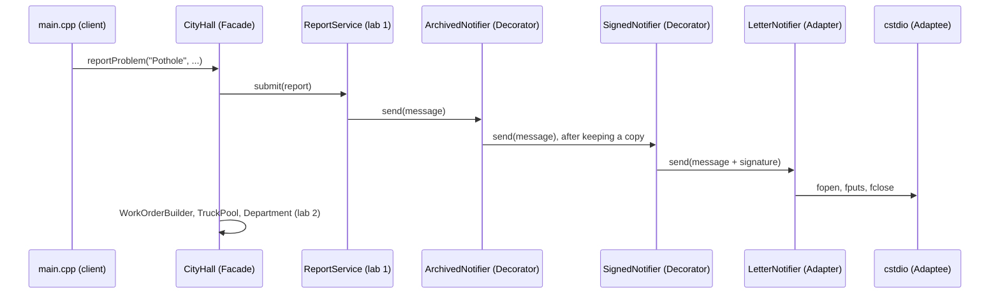
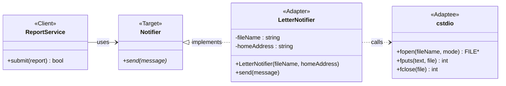
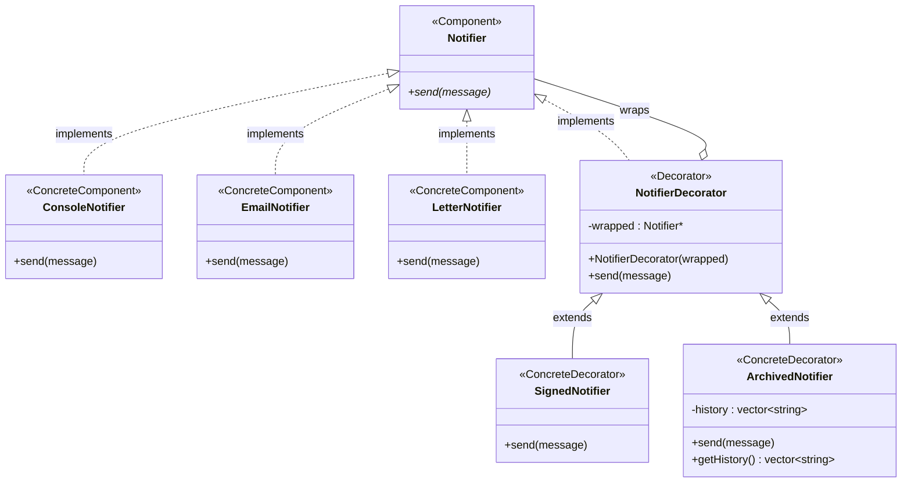
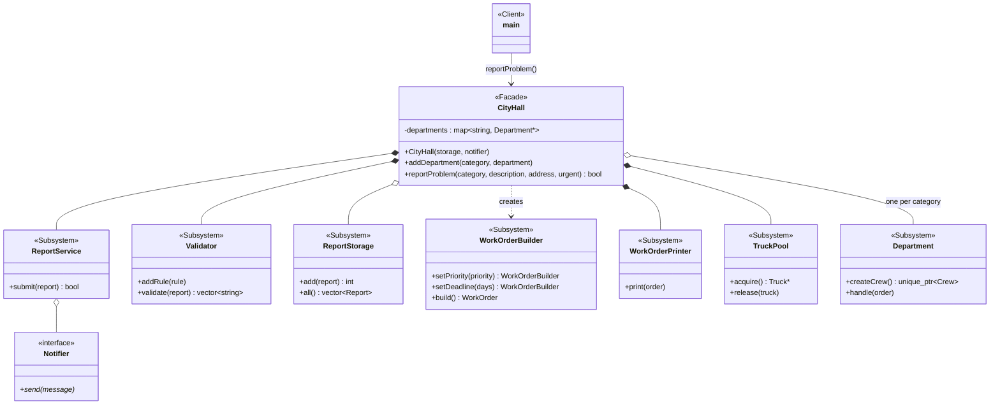

# Laboratory work 3 — Structural design patterns

**Author:** Eftode Andrei, FAF-242

On ELSE this is *Laboratory work #2 — Structural Design Patterns*. In this repository it is
the folder `Lab3`, because the SOLID lab (ELSE #0) is `Lab1`.

## Objectives

- Explain the intent of each structural pattern and the problem it solves.
- Recognize where a structural pattern fits naturally in a codebase, and where it would be forced.
- Implement the patterns so that client code depends on abstractions, not concrete classes.
- Show that the design is open to extension: new variants can be added without modifying existing classes.
- Defend the design choices and adapt the code to a new requirement during the defense.

## Used design patterns

- **Adapter**: `LetterNotifier` adapts the C standard library (`fopen`, `fputs`, `fclose`)
- **Decorator**: `NotifierDecorator`, `SignedNotifier`, `ArchivedNotifier`
- **Facade**: `CityHall`

## 1. Domain description

The application is the backend of a city hall. Citizens report problems in the city (a
pothole, a broken street light, full garbage bins). City hall checks each report, saves it
and tells the citizen what happened. Then it makes a work order and sends the right crew
with a truck. There is no graphical interface: the program runs in the console.

The project grows lab by lab. Lab 1 made the reports, the rules that check them, the storage
and the `Notifier` interface (how the citizen is told). Lab 2 added the creational patterns:
the settings (Singleton), the work orders (Builder), the departments that make their crews
(Factory Method) and the trucks (Object Pool). Lab 3 adds three things the system needs:

- citizens with no phone and no e-mail get a **paper letter**, written with a library the
  project did not write (Adapter);
- every message city hall sends is **signed**, and city hall keeps a **copy** of it (Decorator);
- the whole path of a report, from the citizen to the crew, is **one call** to city hall (Facade).

The classes of lab 1 and lab 2 were not changed. Lab 3 only adds classes.

| Folder | What is in it |
| --- | --- |
| [notifications/](notifications/) | new ways to tell the citizen and the extras around them: `LetterNotifier`, `NotifierDecorator`, `SignedNotifier`, `ArchivedNotifier` |
| [services/](services/) | one entry point for the whole system: `CityHall` |
| [../tests/Lab3Tests.cpp](../tests/Lab3Tests.cpp) | the unit tests |
| [../main.cpp](../main.cpp) | the client: `runLab3()` (menu option 5) and `runLab3Input()` (option 6) |

### How the patterns work together

The three patterns are on one execution path. When the client reports a problem, the call
goes through the facade, then through both decorators, then through the adapter, and
ends in the C library:



`ReportService` only knows the `Notifier` interface, and `CityHall` only gets a `Notifier*`,
so neither of them knows that the message is signed, archived and written on paper. The
client chooses that when it builds the objects in `main.cpp`:

```cpp
LetterNotifier letters("letters.txt", "Ion Popescu, 15 Dacia Blvd.");
SignedNotifier signedLetters(&letters);
ArchivedNotifier archivedLetters(&signedLetters);
CityHall cityHall(&storage, &archivedLetters);
```

## 2. Adapter

> It lets classes work together, that couldn't otherwise because of incompatible parent
> classes. Aka Wrapper. *(slides)*

**The problem.** Some citizens have no phone and no e-mail, so city hall has to send them a
paper letter. The letters are written into a text file that the post office prints. Writing
a file is done with the C standard library (`<cstdio>`). The project did not write it and
can't change it, and its interface does not match the `Notifier` interface that
`ReportService` and `CityHall` use:

| `Notifier` (what the project expects) | `<cstdio>` (what the library gives) |
| --- | --- |
| one call: `send(message)` | three calls in order: `fopen`, `fputs`, `fclose` |
| takes a `std::string` | takes C-style text, `const char*` |
| nothing to open or close | works with a `FILE*` that must be opened and closed |
| knows only the message | needs a file name, and a letter needs the home address |
| shows its own errors | answers with error codes: `nullptr` from `fopen`, `EOF` from `fputs` |

### Class diagram



### Code

[notifications/LetterNotifier.cpp](notifications/LetterNotifier.cpp)

```cpp
void LetterNotifier::send(const string& message) {
    // Notifier has one call, and the C library needs three: open the file, write, close it.
    // "a" opens the file for adding at the end, so the letters written before are kept.
    FILE* file = fopen(fileName.c_str(), "a");

    // The C library does not tell anyone when it fails, it returns nullptr, so the adapter checks it.
    if (file == nullptr) {
        cout << "[letter] The letter could not be written: " << fileName << " can't be opened.\n";
        return;
    }

    // Notifier gives a std::string, and fputs wants C-style text, so the adapter converts it.
    string letter = "To: " + homeAddress + "\n" + message + "\n\n";
    if (fputs(letter.c_str(), file) == EOF) {
        cout << "[letter] The letter could not be written to " << fileName << ".\n";
    } else {
        cout << "[letter to " << homeAddress << "] " << message << "\n";
    }

    fclose(file);
}
```

`LetterNotifier` **is** a `Notifier`, so `ReportService` and `CityHall` use it like any other
notifier. Inside `send()` it translates the one call into the three calls of the C library,
turns `std::string` into C-style text with `c_str()` and turns the error codes into messages.

This is an object adapter: the adapter implements the target and uses the adaptee from
inside. A class adapter would inherit from the adaptee too, but the C library has no class
to inherit from.

### Unit tests

| Test | What it checks |
| --- | --- |
| `testLetterIsWrittenToTheFile` | one `send()`, called through a `Notifier*`, writes the home address and the message into the file through the C library |
| `testLettersAreAddedAtTheEnd` | a second letter goes after the first one and does not overwrite it (`fopen` with `"a"`) |
| `testFileThatCannotBeOpenedIsReported` | when `fopen` returns `nullptr`, the program does not crash and the adapter says the letter could not be written |

```
--- Adapter ---
[PASS] Adapter: send() puts the home address and the message into the file through the C library
[PASS] Adapter: a second letter is added after the first one, not written over it
[PASS] Adapter: when fopen returns nullptr, the adapter says the letter could not be written
```

## 3. Decorator

> Add responsibilities to objects dynamically. Wrap the plain object into a specific
> decorator. *(slides)*

**The problem.** City hall wants two extras for every message: a signature, so the citizen
knows it really comes from city hall, and a copy of every message, so city hall can see
later what it told the citizens. With subclasses, every mix would need its own class:
`SignedEmailNotifier`, `SignedLetterNotifier`, `ArchivedSignedLetterNotifier`, and so on.
With three channels and two extras that is already many classes, and every new channel or
extra multiplies them. A decorator adds one extra and can be put around any notifier, while
the program runs.

### Class diagram



### Code

[notifications/NotifierDecorator.cpp](notifications/NotifierDecorator.cpp),
[notifications/SignedNotifier.cpp](notifications/SignedNotifier.cpp),
[notifications/ArchivedNotifier.cpp](notifications/ArchivedNotifier.cpp)

```cpp
NotifierDecorator::NotifierDecorator(Notifier* wrapped) {
    this->wrapped = wrapped;
}

void NotifierDecorator::send(const string& message) {
    wrapped->send(message);
}

void SignedNotifier::send(const string& message) {
    // The added part: the signature. Sending the message is still the wrapped notifier's job.
    NotifierDecorator::send(message + " -- Chisinau City Hall");
}

void ArchivedNotifier::send(const string& message) {
    // The added part: the copy. Sending the message is still the wrapped notifier's job.
    history.push_back(message);
    NotifierDecorator::send(message);
}
```

The decorator is a `Notifier` and also keeps a `Notifier` inside it. Each concrete decorator
does its small job and then calls `NotifierDecorator::send()`, which passes the message to the
wrapped notifier, so decorators can be put one inside another, in any order.

The order matters. `ArchivedNotifier` outside `SignedNotifier` keeps the text before the
signature is added; the other way around, it keeps the signed text. The citizen gets the
signed message in both cases.

### Unit tests

| Test | What it checks |
| --- | --- |
| `testSignatureIsAdded` | `SignedNotifier` adds the signature and passes the message to the wrapped notifier (a stub that only records the messages) |
| `testDecoratorsWorkInAnyOrder` | archive outside the signature and signature outside the archive: in both orders the citizen gets the signed message, and the order decides what the archive keeps |
| `testDecoratorWrapsTheAdapter` | the signature also works around `LetterNotifier`, so the letter in the file is signed, and `LetterNotifier` was not changed |

```
--- Decorator ---
[PASS] Decorator: SignedNotifier adds the signature and passes the message to the wrapped notifier
[PASS] Decorator: in both orders the citizen gets the signed message
[PASS] Decorator: the order of the decorators decides what the archive keeps
[PASS] Decorator: the signature also works around the letter adapter, without changing it
```

## 4. Facade

> Provides a unified interface that represents multiple components. Wraps a complex
> sub-system with a simple abstraction. *(slides)*

**The problem.** After lab 2, handling one report needed many classes, used in the right
order: the rules and the `Validator`, `ReportService`, the `ReportStorage`, the
`WorkOrderBuilder` and its printer, the `TruckPool` and the right department. The client
had to know all of them, and in lab 2 `runLab2Input()` really does every step by hand. The
lab task also asks that the creational patterns are used inside the functionalities, not
in the client. `CityHall` keeps the parts of the system inside it and gives the client one
method, `reportProblem()`.

### Class diagram



`*--` means city hall makes the part itself and keeps it inside, `o--` means it gets the part
from outside and only points to it, and `..>` means it only uses the class inside a method.

### Code

[services/CityHall.cpp](services/CityHall.cpp) (the comments are left out here)

```cpp
bool CityHall::reportProblem(const string& category, const string& description,
                             const string& address, bool urgent) {
    if (!reportService.submit(Report(category, description))) {
        return false;
    }
    vector<Report> reports = storage->all();
    const Report& report = reports.back();

    WorkOrderBuilder builder(report, address);
    if (urgent) {
        builder.setPriority("High").setDeadline(2);
    }
    WorkOrder order = builder.build();
    orderPrinter.print(order);

    if (departments.count(category) == 0) {
        cout << "No department takes care of \"" << category << "\" yet, so the work order waits.\n";
        return true;
    }
    Truck* truck = trucks.acquire();
    if (truck == nullptr) {
        cout << "No truck is free, so the work order waits.\n";
        return true;
    }
    cout << "Truck #" << truck->number << " goes out. ";
    departments[category]->handle(order);
    trucks.release(truck);
    return true;
}
```

The facade does not do the work itself: every step is one call to a class of lab 1 or lab 2
(lab 1's service, the Builder, the Object Pool, the Factory Method of the department). The
client now needs only `cityHall.reportProblem("Pothole", "Deep pothole in front of the
hospital", "Ismail St. 40", true)`.

The facade is open for extension. The client tells city hall which department takes care of
which category, so a new department is a new class and one more line in the client, and
`CityHall` does not change:

```cpp
RoadDepartment roads;
LightingDepartment lighting;
SanitationDepartment sanitation;
cityHall.addDepartment("Pothole", &roads);
cityHall.addDepartment("Street light", &lighting);
cityHall.addDepartment("Garbage", &sanitation);
```

The subsystem is not hidden completely: its classes are still public, so code that needs
something special can still use them directly.

### Unit tests

| Test | What it checks |
| --- | --- |
| `testAcceptedReportGoesThroughEveryStepInOrder` | one call saves the report, and the steps run in the right order: the citizen is told, then the work order is made, then a truck goes out, then the crew works |
| `testRefusedReportGetsNoWorkOrder` | a refused report is not saved and gets no work order, and the citizen is told why (checked with the recording stub) |
| `testEachCategoryGoesToItsDepartment` | the department given with `addDepartment()` for a category is the one that sends its crew |

The order is checked on the text the subsystem writes on the screen: the test sends `cout`
into a string for a moment and checks that each step's line comes before the next one.

```
--- Facade ---
[PASS] Facade: one call to reportProblem() saves the report
[PASS] Facade: the steps run in the right order: citizen told, work order, truck, crew
[PASS] Facade: a refused report is not saved and gets no work order
[PASS] Facade: the citizen is told why the report was refused
[PASS] Facade: the department added for the category is the one that sends its crew
```

## 5. How the requirements are met

| Requirement from the lab sheet | Where |
| --- | --- |
| Three structural patterns, each with its full structure | Adapter: target, adapter, adaptee. Decorator: component, three concrete components, base decorator, two concrete decorators. Facade: facade and its subsystem |
| The patterns interact | one call goes through the Facade, both Decorators and the Adapter (the sequence diagram above) |
| The client depends on abstractions | `ReportService` and `CityHall` know only `Notifier*` and `Department*` |
| Open for extension | a new channel is a new `Notifier`, a new extra is a new `NotifierDecorator`, a new department is a new class and one `addDepartment()` line; no existing class changes |
| Build on the creational lab | `CityHall` uses the Builder, the Factory Method, the Object Pool and the Singleton (`AppConfig`) from lab 2 |
| Clean structure | `notifications/`, `services/`, the client in `main.cpp`, the tests in `tests/` |
| Runnable demo | menu option 5 (ready example) and option 6 (your own reports) |
| Adapt a library you cannot change | the C standard library (`<cstdio>`) |
| At least 2 unit tests per pattern | 12 tests in [../tests/Lab3Tests.cpp](../tests/Lab3Tests.cpp), they run with one command |

How to build, run and test is in [README.md](README.md).

## 6. The other structural patterns

The task asks to know the rest of the list too.

| Pattern | Slides | Where it could fit in this project |
| --- | --- | --- |
| Bridge | Separates an object's abstraction from its implementation so that these two levels could vary independently. Use it when you have 2 orthogonal dimensions. | the kinds of messages (report accepted, report refused, work done) on one side, and the channels (console, e-mail, letter) on the other |
| Composite | A tree structure of simple and complex objects. It lets clients treat simple and complex objects uniformly. | a team of several crews used like one `Crew`, for a big job that needs the road crew and the garbage crew together |
| Flyweight | Use sharing to support large numbers of fine grained objects efficiently. Intrinsic: state independent part. Extrinsic: state dependent part. | the data of a category (its name and its department) shared by thousands of reports, instead of every report keeping its own copy |
| Proxy | An object representing another object. Control the access to an object by wrapping it into another. | a notifier that sends letters only to citizens who agreed to get them, with the same `send()` as the real one |

The project does not need them yet: there are no two dimensions that change on their own,
no tree of objects, not enough reports to save memory, and no access to control.

## 7. Results

The ready example, menu option 5:

```
=== Laboratory work 3: Structural design patterns ===

--- 1. Adapter ---
ReportService from lab 1 gets a LetterNotifier, and its code stays the same:
[letter to Ion Popescu, 15 Dacia Blvd.] Report #1 was registered.
[letter to Ion Popescu, 15 Dacia Blvd.] Report refused: The description must have at least 10 characters.
A file that can't be opened makes fopen return nullptr, and the adapter says so:
[letter] The letter could not be written: no_such_folder/letters.txt can't be opened.

--- 2. Decorator ---
The letter notifier, wrapped so every message is signed and kept in the archive:
[letter to Ion Popescu, 15 Dacia Blvd.] Report #2 was registered. -- Chisinau City Hall
The same signature works on any notifier, for example on e-mail:
[e-mail] The street lights on Ion Creanga St. were repaired. -- Chisinau City Hall
The archive kept 1 message(s):
  - Report #2 was registered.

--- 3. Facade ---
[config] The settings were loaded.
An urgent pothole, reported with one call:
[letter to Ion Popescu, 15 Dacia Blvd.] Report #3 was registered. -- Chisinau City Hall
Work order for report #3 (Pothole)
  address:  Ismail St. 40
  priority: High
  deadline: 2 days
Truck #1 goes out. Report #3 (High priority, 2 days): the road crew fills the pothole at Ismail St. 40.

A broken street light that is not urgent:
[letter to Ion Popescu, 15 Dacia Blvd.] Report #4 was registered. -- Chisinau City Hall
Work order for report #4 (Street light)
  address:  Mihai Viteazul St. 7
  priority: Normal
  deadline: 7 days
Truck #1 goes out. Report #4 (Normal priority, 7 days): the electricians repair the street light at Mihai Viteazul St. 7.

A report that is refused does not get a work order:
[letter to Ion Popescu, 15 Dacia Blvd.] Report refused: "Aliens" is not a known category. -- Chisinau City Hall
[letter to Ion Popescu, 15 Dacia Blvd.] Report refused: The description must have at least 10 characters. -- Chisinau City Hall

Every letter city hall sent in this example:
  - Report #2 was registered.
  - Report #3 was registered.
  - Report #4 was registered.
  - Report refused: "Aliens" is not a known category.
  - Report refused: The description must have at least 10 characters.
The letters are in the file letters.txt, ready for the post office.
```

The letters written for the post office, in `letters.txt`:

```
To: Ion Popescu, 15 Dacia Blvd.
Report #1 was registered.

To: Ion Popescu, 15 Dacia Blvd.
Report refused: The description must have at least 10 characters.

To: Ion Popescu, 15 Dacia Blvd.
Report #2 was registered. -- Chisinau City Hall

...
```

All the unit tests:

```
=== Unit tests of laboratory work 3: structural design patterns ===

--- Adapter ---
[PASS] Adapter: send() puts the home address and the message into the file through the C library
[PASS] Adapter: a second letter is added after the first one, not written over it
[PASS] Adapter: when fopen returns nullptr, the adapter says the letter could not be written

--- Decorator ---
[PASS] Decorator: SignedNotifier adds the signature and passes the message to the wrapped notifier
[PASS] Decorator: in both orders the citizen gets the signed message
[PASS] Decorator: the order of the decorators decides what the archive keeps
[PASS] Decorator: the signature also works around the letter adapter, without changing it

--- Facade ---
[PASS] Facade: one call to reportProblem() saves the report
[PASS] Facade: the steps run in the right order: citizen told, work order, truck, crew
[PASS] Facade: a refused report is not saved and gets no work order
[PASS] Facade: the citizen is told why the report was refused
[PASS] Facade: the department added for the category is the one that sends its crew

12 tests, 12 passed, 0 failed.
```

## 8. Conclusions

The hardest part was the Adapter. My first version adapted an SMS gateway class that I had
written myself, so there was no real incompatibility: I had made the "foreign" interface
myself. A real adapter needs code I can't change. The C library's file functions are such
code: they have a different way of working (open, write, close), C-style text and error codes
instead of messages, and the adapter has to deal with all of that behind one `send()`.

Testing was harder than I expected too. The decorators were easy to test with a small stub
that only remembers the messages. The facade was harder, because its steps write on the
screen instead of returning something, so the test has to catch the screen output and check
the order of the lines. I also saw that the order of the decorators changes the result: the
archive keeps the signed or the unsigned text depending on which decorator is outside.

If I did it again, I would change two things. First, the list of categories is still fixed
inside `CategoryRule` from lab 1, so a new category needs a change there, even though the
facade itself no longer needs one. I would let the departments given to city hall decide
which categories are known. Second, the facade and the classes of lab 2 write directly on
the screen with `cout`. If they returned their results or used a printer interface, the
tests would be simpler and the same classes could work without a console.

## C++ used in the code

New things compared to lab 1 and lab 2:

| In the code | What it means |
| --- | --- |
| `#include <cstdio>` | the C standard library for files: `fopen`, `fputs`, `fclose`, `FILE`, `EOF` |
| `FILE* file = fopen(name, "a")` | opens a file and gives a pointer to it; `"a"` means "add at the end"; it returns `nullptr` if the file can't be opened |
| `fputs(text, file) == EOF` | writes C-style text into the file; `EOF` is the code it returns when it fails |
| `fclose(file)` | closes the file, so everything written is saved |
| `message.c_str()` | gives the text of a `std::string` as C-style text, so it can be passed to a C function |
| `SignedNotifier(Notifier* wrapped) : NotifierDecorator(wrapped) {}` | the constructor first calls the constructor of the base class and gives it `wrapped` |
| `NotifierDecorator::send(message)` | calls the method of the base class, not the one of the current class |
| `const vector<string>& getHistory() const` | returns the list itself, not a copy, and the caller can only read it |
| `map<string, const Department*> departments` | a dictionary: for each category (the key) it keeps the department (the value) |
| `departments.count(category) == 0` | the category is not in the dictionary |
| `departments[category]->handle(order)` | finds the department of the category and calls its method through the pointer |
| `: storage(storage), reportService(storage, &validator, notifier), trucks(...)` | the initializer list makes the objects that `CityHall` keeps inside it, with their constructor arguments |
| `cout.rdbuf(capturedScreen.rdbuf())` (tests) | for a moment, `cout` writes into a string instead of the screen, so a test can read what was printed |
