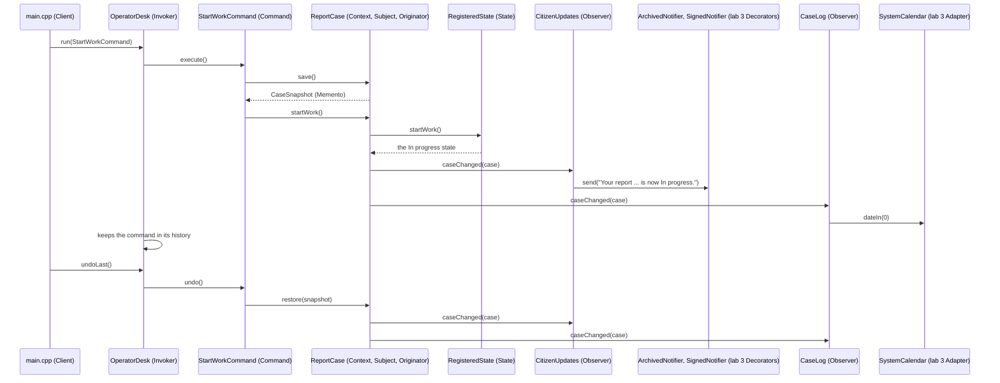
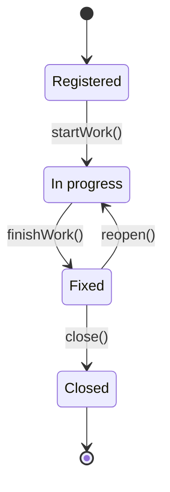
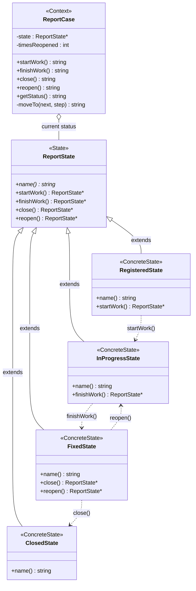
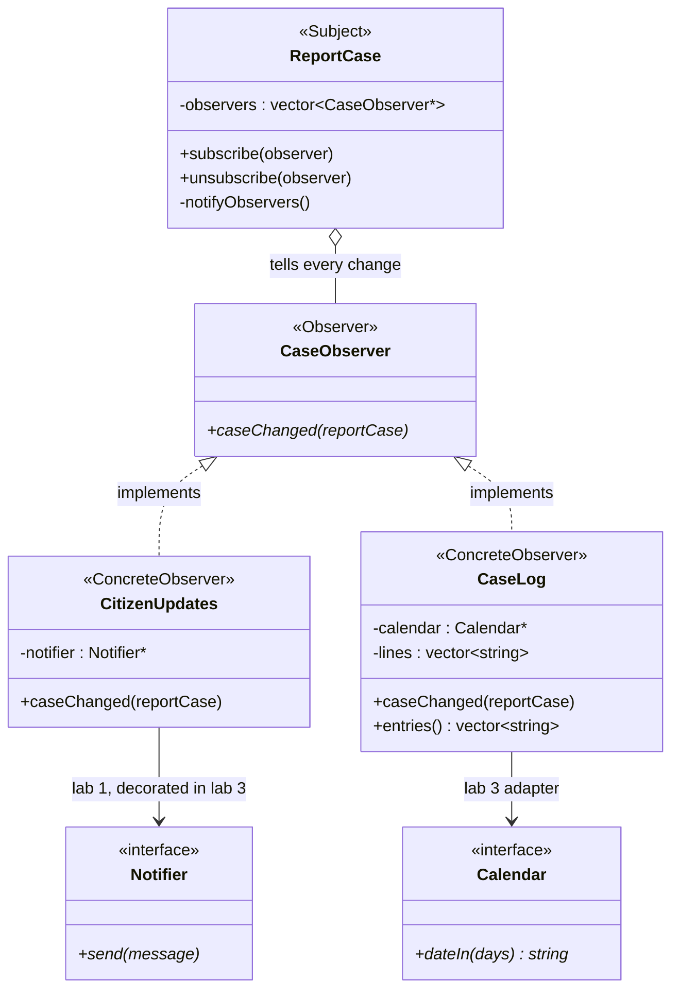
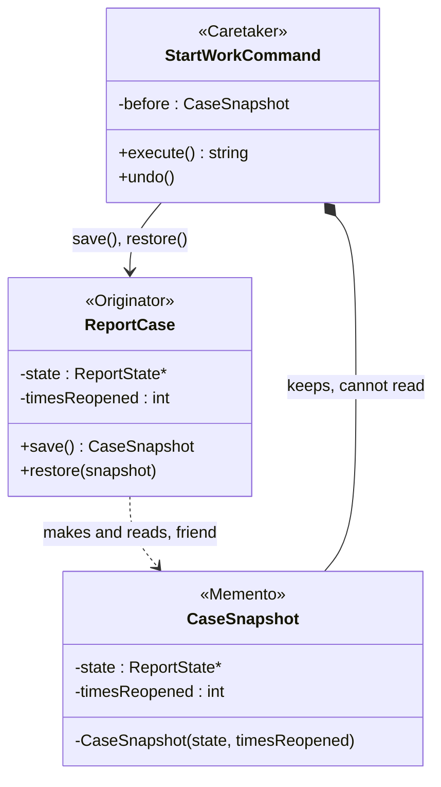
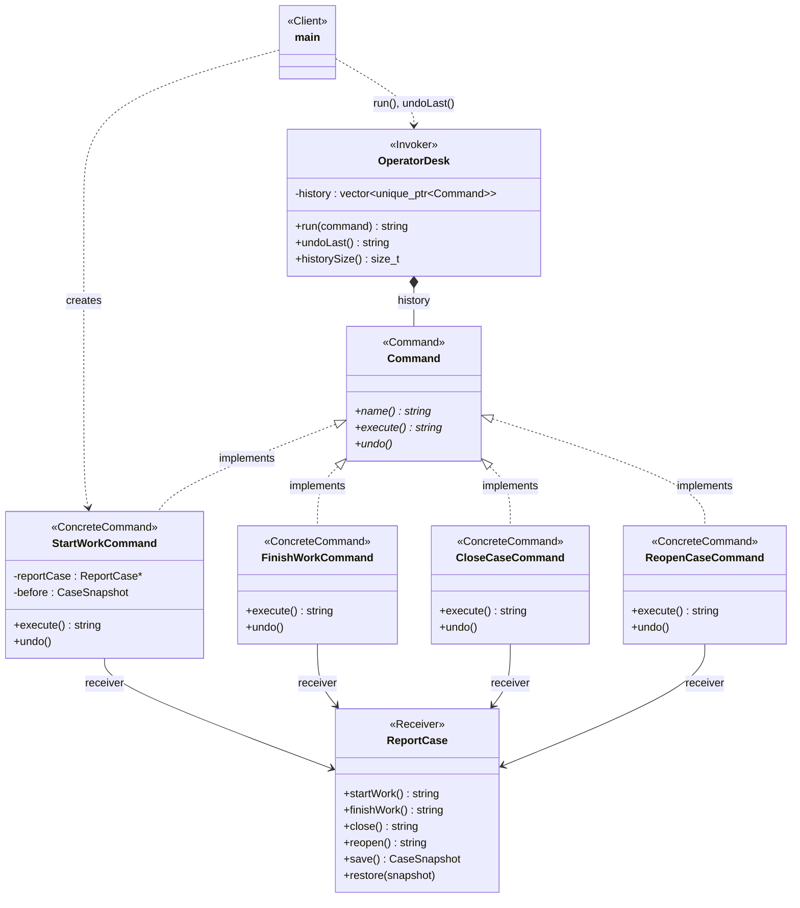

# Laboratory work 4 — Behavioral design patterns

**Author:** Eftode Andrei, FAF-242

## Objectives

- Explain the intent of each behavioral pattern and how it distributes responsibilities and communication between objects.
- Recognize where a behavioral pattern fits naturally in a codebase, and where it would be forced.
- Implement the patterns so that behavior can be changed or extended without modifying existing classes.
- Show that objects communicate through abstractions rather than hard-coded dependencies.
- Defend the design choices and adapt the code to a new requirement during the defense.

## Used design patterns

The task asks for at least 3 behavioral patterns. This project uses 4, and all of them are on
the path of one command of the city hall operator:

- **State**: `ReportCase` and its statuses `RegisteredState`, `InProgressState`, `FixedState`, `ClosedState`
- **Observer**: `CaseObserver`, `CitizenUpdates`, `CaseLog`, told by `ReportCase`
- **Memento**: `CaseSnapshot`, made and read only by `ReportCase`
- **Command**: `StartWorkCommand`, `FinishWorkCommand`, `CloseCaseCommand`, `ReopenCaseCommand`, run by `OperatorDesk`

## 1. Domain description

The application is the backend of a city hall. Citizens report problems in the city (a
pothole, a broken street light, full garbage bins, storm damage). City hall checks each
report, saves it, tells the citizen, makes a work order and sends the right crew with a truck.
There is no graphical interface: the program runs in the console.

The project grows lab by lab. Lab 1 made the reports, the rules, the storage and the
`Notifier` interface. Lab 2 added the creational patterns (settings, work orders, departments
that make their crews, trucks). Lab 3 added the structural ones: the real date of every work
order (Adapter), the signed and archived messages (Decorator), the storm team (Composite) and
`CityHall`, one call for the whole path of a report (Facade).

Lab 3 ends when the crew goes out. Lab 4 follows every report until it is closed. A city hall
operator moves the report's **case** through its life: Registered, then In progress when the
crew starts, then Fixed when the crew says it is done, then Closed when the citizen confirms.
If the citizen says the problem is still there, the case is reopened and goes back to In
progress. Lab 4 adds four things the system needs:

- what the operator may do depends on the status of the case: a case that was never started
  can't be finished, and a closed case can't change any more (State);
- the citizen and the city hall log are told about every change, and the citizen can stop the
  updates and start them again (Observer);
- a case can be saved and put back exactly as it was, without anybody else seeing what is
  inside it (Memento);
- every action of the operator is an object that the desk remembers, so a mistake can be
  undone, for example a case closed too early (Command).

The classes of labs 1, 2 and 3 were not changed. Lab 4 only adds classes.

The folders are named after what the code does in the city. The domain models are the data
classes: `Report` (lab 1), `WorkOrder` and `Truck` (lab 2), and the case of a report with its
snapshot (lab 4, `cases/`). The client code is `main.cpp`, and the tests are in `tests/`.

| Folder | What is in it |
| --- | --- |
| [cases/](cases/) | the case of one report and its saved copy: `ReportCase`, `CaseSnapshot` |
| [statuses/](statuses/) | what a case may do in each status: `ReportState`, `RegisteredState`, `InProgressState`, `FixedState`, `ClosedState` |
| [updates/](updates/) | who hears about a change: `CaseObserver`, `CitizenUpdates`, `CaseLog` |
| [operator/](operator/) | the operator's actions and desk: `Command`, `StartWorkCommand`, `FinishWorkCommand`, `CloseCaseCommand`, `ReopenCaseCommand`, `OperatorDesk` |
| [../tests/Lab4Tests.cpp](../tests/Lab4Tests.cpp) | the unit tests |
| [../main.cpp](../main.cpp) | the client: `runLab4()` (menu option 7) and `runLab4Input()` (option 8) |

### How the patterns work together

All four patterns are on one execution path. When the operator starts the work on a case, the
desk runs the command, the command saves a snapshot, the current status of the case decides
the next one, and the observers are told. The citizen's message goes through the decorators of
lab 3, and the date in the log comes from the adapter of lab 3. Undo goes back the same way:



`OperatorDesk` knows only `Command`, `ReportCase` knows only `ReportState` and `CaseObserver`,
`CitizenUpdates` knows only `Notifier` and `CaseLog` knows only `Calendar`. The client chooses
the real objects when it builds them in `main.cpp` (these lines are from `runLab4()`, put
together):

```cpp
SystemCalendar calendar(time(nullptr));
EmailNotifier email;
SignedNotifier signedEmail(&email);
ArchivedNotifier archivedEmail(&signedEmail, &archive);
CityHall cityHall(&storage, &archivedEmail, &calendar);
cityHall.reportProblem("Storm damage", "A tree fell across Grenoble St. after the storm",
                       "Grenoble St. 120", true);

ReportCase stormCase(storage.all().back());
CitizenUpdates citizen(&archivedEmail);
CaseLog caseLog(&calendar);
stormCase.subscribe(&citizen);
stormCase.subscribe(&caseLog);

OperatorDesk desk;
desk.run(make_unique<StartWorkCommand>(&stormCase));
desk.undoLast();
```

## 2. State

> Change an object's behavior when its internal state changes. *(lab sheet)*

**The problem.** A case can do different things in different statuses. The crew can start a
case that is Registered, but not one that is already In progress. Only a Fixed case can be
closed or reopened, and a Closed case can't change any more. Written with a status text and
`if`/`switch`, every method of the case would check every status, and a new status would mean
changing all of them. With the State pattern every status is its own class that knows only its
own rules, and the case asks its current status what comes next.



Every arrow that is not in this picture is refused, and the case says why.

### Class diagram



### Code

[cases/ReportCase.cpp](cases/ReportCase.cpp), [statuses/ReportState.cpp](statuses/ReportState.cpp),
[statuses/FixedState.cpp](statuses/FixedState.cpp)

```cpp
string ReportCase::finishWork() {
    return moveTo(state->finishWork(), "the work can't be finished");
}

string ReportCase::moveTo(const ReportState* next, const string& step) {
    // nullptr means the step is forbidden
    if (next == nullptr) {
        return step + ", the case is " + state->name() + ".";
    }
    state = next;
    notifyObservers();
    return "";
}

// Implicit, niciun pas nu e permis
const ReportState* ReportState::close() const {
    return nullptr;
}

const ReportState* FixedState::close() const {
    // Cetățeanul confirmă, cazul se închide
    static const ClosedState closed;
    return &closed;
}
```

The case does not decide anything itself: it asks its current status for the next one. The
base class `ReportState` refuses every step (it returns `nullptr`), and each concrete status
overrides only the steps it allows, so the rules of a status are all in its own class and there
is no `switch` anywhere.

A status has no data of its own, only behavior, so one object of each status is enough for
every case. It is made once, as a `static` object inside the method, and every case only points
to it. `moveTo()` is private: client code can't set a status, it can only ask for a step.

The empty text means "done", like the rules of lab 1 (`Rule::check()`). Otherwise the case
returns the reason, for example `the work can't be finished, the case is Registered.`

### Unit tests

| Test | What it checks |
| --- | --- |
| `testEveryStatusIsAReportState` | `ReportState` can't be made on its own (it is abstract), and the four statuses inherit from it |
| `testFullLifeOfACase` | the valid path: Registered, In progress, Fixed, Closed, every step returns the empty text |
| `testForbiddenStepsAreRefused` | a new case refuses to be finished or closed and stays Registered; a closed case refuses to start or reopen and stays Closed; each refusal says why |
| `testReopenSendsTheCrewBack` | a Fixed case can be reopened, goes back to In progress, can be fixed again, and the reopening is counted |

```
--- State ---
[PASS] State: ReportState is abstract and the four statuses are ReportStates
[PASS] State: a case goes Registered -> In progress -> Fixed -> Closed
[PASS] State: a new case refuses to be finished or closed, says why, and stays Registered
[PASS] State: a closed case refuses every step and stays Closed
[PASS] State: a fixed case can be reopened, goes back to In progress and is counted
```

## 3. Observer

> Notify dependent objects automatically when an object's state changes. *(lab sheet)*

**The problem.** When a case changes, several parts of city hall need to know: the citizen who
reported the problem, and the city hall log that keeps the date of every change. If the case
called them by name, it would depend on all of them, and every new listener (for example the
district office) would mean changing the case. Also, a citizen may not want e-mails for every
step. With the Observer pattern the case keeps a list of observers behind one interface, tells
all of them after every change, and anyone can subscribe or unsubscribe while the program runs.

### Class diagram



### Code

[cases/ReportCase.cpp](cases/ReportCase.cpp), [updates/CitizenUpdates.cpp](updates/CitizenUpdates.cpp)

```cpp
void ReportCase::subscribe(CaseObserver* observer) {
    observers.push_back(observer);
}

void ReportCase::unsubscribe(CaseObserver* observer) {
    // Scoatem doar observatorul cerut
    for (size_t i = 0; i < observers.size(); i++) {
        if (observers[i] == observer) {
            observers.erase(observers.begin() + i);
            return;
        }
    }
}

void ReportCase::notifyObservers() const {
    // Everyone subscribed hears it
    for (CaseObserver* observer : observers) {
        observer->caseChanged(*this);
    }
}

void CitizenUpdates::caseChanged(const ReportCase& reportCase) {
    // Only reads the case, never changes it
    notifier->send("Your report #" + to_string(reportCase.getReportId()) + " (" + reportCase.getCategory()
                   + ") is now " + reportCase.getStatus() + ".");
}
```

The case keeps only `CaseObserver*` pointers, so it does not know who listens. `moveTo()` and
`restore()` call `notifyObservers()` after every real change; a refused step changes nothing,
so nobody is told.

The observers get the case as a `const` reference: they can read it but can't change it, so a
notification can never start another change and another notification (no endless loop).
`CitizenUpdates` sends through any `Notifier`. In `main.cpp` it gets the e-mail notifier wrapped
by the two decorators of lab 3, so every update is signed and archived. `CaseLog` takes the
date from the `Calendar` of lab 3, the adapter over the C library.

### Unit tests

| Test | What it checks |
| --- | --- |
| `testEverySubscribedObserverIsTold` | one change is told to both observers: the citizen gets the right message, and the log gets one line with the date |
| `testUnsubscribedObserverIsNotTold` | after `unsubscribe()` the citizen gets nothing while the log still gets the change; after subscribing again at runtime the citizen is told again |
| `testRefusedStepTellsNobody` | a refused step (finish or close a new case) sends no message |
| `testCitizenUpdateGoesThroughTheLab3Decorators` | the citizen's update is signed by `SignedNotifier` and the archive of `ArchivedNotifier` keeps a copy |

The tests use a recording notifier (a stub that only keeps the messages) and a calendar that
always counts from 20 November 2026, so the dates in the log are always the same.

```
--- Observer ---
[PASS] Observer: one change of status is told to every subscribed observer
[PASS] Observer: an unsubscribed observer is not told, the others still are
[PASS] Observer: after subscribing again at runtime, the observer is told again
[PASS] Observer: a refused step changes nothing, so nobody is told
[PASS] Observer: the citizen's update is signed and archived by the decorators of lab 3
```

## 4. Memento

> Capture and restore an object's state without breaking encapsulation. *(lab sheet)*

**The problem.** To undo a step, city hall must put a case back exactly as it was: its status
and how many times it was reopened. If the case gave out its fields with setters, any code
could change a status without the rules of section 2, and the State pattern would mean nothing.
With the Memento pattern the case makes a sealed copy of itself, `CaseSnapshot`. Other code can
keep the copy and give it back, but only the case can make it and read what is inside.

### Class diagram



The other three commands keep their snapshot the same way as `StartWorkCommand`.

### Code

[cases/CaseSnapshot.h](cases/CaseSnapshot.h), [cases/ReportCase.cpp](cases/ReportCase.cpp)

```cpp
// Copia cazului, închisă pentru ceilalți
class CaseSnapshot {
private:
    // Only ReportCase may open it
    friend class ReportCase;

    CaseSnapshot(const ReportState* state, int timesReopened);

    const ReportState* state;
    int timesReopened;
};

CaseSnapshot ReportCase::save() const {
    return CaseSnapshot(state, timesReopened);
}

void ReportCase::restore(const CaseSnapshot& snapshot) {
    // Everything comes back, then tell
    state = snapshot.state;
    timesReopened = snapshot.timesReopened;
    notifyObservers();
}
```

Everything in `CaseSnapshot` is private, even the constructor. `friend class ReportCase;` lets
only the case make a snapshot and read it. Any other code can copy a snapshot and give it back
to `restore()`, but it can't look inside or build a fake one.

A snapshot keeps its own copy of the values: an `int` and a pointer to a status object that
never changes (the statuses are `const` and shared, see section 2). So later changes of the
case can't change a snapshot that was already saved, and the same snapshot can be restored
more than once. `restore()` tells the observers too, because the status really changed.

### Unit tests

| Test | What it checks |
| --- | --- |
| `testRestoreGivesBackTheExactState` | a case saved when it is Fixed and was reopened once, then closed: `restore()` gives back Fixed and 1, and from there the rules of Fixed work again (it can be closed) |
| `testLaterChangesDoNotTouchTheSnapshot` | a snapshot saved when the case is Registered; after several changes it still gives back Registered and 0, and it can be restored a second time |
| `testOnlyTheCaseCanMakeASnapshot` | outside code can copy a snapshot, but can't make an empty one or fill one in (checked with `is_copy_constructible`, `is_default_constructible`, `is_constructible`) |
| `testRestoreIsToldToTheObservers` | after `restore()` the citizen is told the status that came back |

```
--- Memento ---
[PASS] Memento: restore() gives back the exact saved case, its status and how often it was reopened
[PASS] Memento: after restore() the restored status decides the next step again
[PASS] Memento: changes made after save() do not change the snapshot, it can be restored again
[PASS] Memento: outside code can keep a copy of a snapshot, but can't make one or fill it in
[PASS] Memento: after restore() the observers are told the status that came back
```

## 5. Command

> Turn a request into an object so it can be queued, logged or undone. *(lab sheet)*

**The problem.** The operator at city hall makes mistakes, for example closes a case before the
citizen checked the street. If every action were only a method call, there would be nothing to
take back. With the Command pattern every action is an object with `execute()` and `undo()`.
The desk runs it, writes it in the console (a log of what the operator did) and keeps it in a
history, so the newest action can be undone, then the one before it, and so on.

### Class diagram



### Code

[operator/StartWorkCommand.cpp](operator/StartWorkCommand.cpp), [operator/OperatorDesk.cpp](operator/OperatorDesk.cpp)

```cpp
string StartWorkCommand::execute() {
    // Remember the case, then ask it
    before = reportCase->save();
    return reportCase->startWork();
}

void StartWorkCommand::undo() {
    reportCase->restore(before);
}

string OperatorDesk::run(unique_ptr<Command> command) {
    cout << "Operator: " << command->name() << "\n";
    string refusal = command->execute();

    // Un pas refuzat nu se păstrează
    if (!refusal.empty()) {
        cout << "  refused: " << refusal << "\n";
        return refusal;
    }
    history.push_back(move(command));
    return "";
}

string OperatorDesk::undoLast() {
    if (history.empty()) {
        cout << "Operator: undo, but there is nothing to undo.\n";
        return "there is nothing to undo";
    }

    // The newest command goes first
    unique_ptr<Command> last = move(history.back());
    history.pop_back();
    cout << "Operator: undo \"" << last->name() << "\"\n";
    last->undo();
    return "";
}
```

`execute()` and `undo()` are a pair: before the step the command saves a snapshot (Memento),
and `undo()` gives the same snapshot back. The command has no business logic: whether the step
is allowed is decided by the case and its status (State). The desk knows only the `Command`
interface. It keeps only the commands that were really done, and undoes them newest first.

Undo does not go through the status rules on purpose: it is not a new step in the life of the
case, it puts back the copy from before (a Closed case can't be reopened by a step, but a close
made by mistake can be undone).

### Unit tests

| Test | What it checks |
| --- | --- |
| `testExecuteThenUndoRestoresTheCase` | a start command makes the case In progress, and undo gives back Registered with an empty history |
| `testUndoGoesBackStepByStep` | five commands (start, finish, reopen, finish, close), then undo one at a time: Fixed, then before the reopening (Fixed, reopened 0 times), and at the end Registered |
| `testRefusedCommandIsNotKept` | a command the status refuses returns the reason and is not kept; undo on an empty desk is safe |
| `testDeskWorksWithAnyCommand` | a new command class written only in the test works with the desk, and undo works for it too: a new command needs no change in `OperatorDesk` |
| `testOneCommandGoesThroughAllFourPatterns` | one command through the whole path: the state changes, the citizen gets the signed message (lab 3), the log gets the dated line, and undo puts the snapshot back and tells everyone again |

```
--- Command ---
[PASS] Command: executing a command and then undoing it gives back the original case
[PASS] Command: undo goes back one command at a time, the newest first
[PASS] Command: a command the status refuses is not kept, and undo on an empty desk is safe
[PASS] Command: OperatorDesk knows only the Command interface, so a new command needs no change in it

--- All four together ---
[PASS] Together: one command changes the state, and the citizen (signed, lab 3) and the log are told
[PASS] Together: undo puts the snapshot back, and the citizen and the log are told again
```

## 6. How the requirements are met

| Requirement from the lab sheet | Where |
| --- | --- |
| 1. Three behavioral patterns, each with its full structure | four. State: context `ReportCase`, state `ReportState`, four concrete states with transitions. Observer: subject `ReportCase` with `subscribe()`/`unsubscribe()`, observer `CaseObserver`, two concrete observers. Memento: originator `ReportCase`, memento `CaseSnapshot`, caretakers (the commands). Command: `Command`, four concrete commands, receiver `ReportCase`, invoker `OperatorDesk` with history and undo, client `main.cpp` |
| 2. Patterns must interact | one `desk.run()` goes through Command, Memento, State and Observer, and on to the decorators and the adapter of lab 3 (the sequence diagram in section 1) |
| 3. Client code depends on abstractions | `OperatorDesk` knows only `Command`; `ReportCase` knows only `ReportState` and `CaseObserver`; `CitizenUpdates` knows only `Notifier`; `CaseLog` knows only `Calendar` |
| 4. Open for extension | a new command or a new observer is a new class only (the test with `CountingCommand` shows it for commands); a new status is a new class plus the one line in the status it comes from (see section 9) |
| 5. Build on lab 2 | every report is registered by `CityHall`, the facade of lab 3, which uses the Builder, the Factory Method, the Object Pool and the Singleton of lab 2; the citizen's updates go through the decorators of lab 3; the dates in the log come from the adapter of lab 3; the storm case is handled by the composite team of lab 3 |
| 6. Clean project structure | the domain models (`Report`, `ReportCase`, `CaseSnapshot`), the pattern classes in folders named after what they do (`statuses/`, `updates/`, `operator/`), the client in `main.cpp`, the tests in `tests/` |
| 7. A runnable demo | menu option 7 (ready example, one section per pattern) and option 8 (your own report) |
| A. Behavior changes at runtime | option 8: the user chooses the operator's commands while the program runs (the case moves between states, undo works), and option 6 of that menu unsubscribes or subscribes the citizen again |
| B. Unit tests | 21 tests in [../tests/Lab4Tests.cpp](../tests/Lab4Tests.cpp), 4 to 5 per pattern and 2 for all four together, they run with one command |

The lab sheet lists the mistakes that lose points. This is how the project avoids the ones of
its patterns:

| Pattern | Mistake from the lab sheet | In this project |
| --- | --- | --- |
| State | a `switch` on a state enum inside the context; transitions scattered in client code | no `switch`: each status returns the next one; `moveTo()` is private, so client code can only ask for a step |
| Observer | the subject depends on concrete observers; observers can't unsubscribe; endless update loops | `ReportCase` keeps only `CaseObserver*`; `unsubscribe()` is used at runtime; observers get a `const ReportCase&`, so they can't start a new change |
| Memento | the memento shows the originator's state publicly; snapshots share mutable references | everything in `CaseSnapshot` is private and only `ReportCase` is its friend; a snapshot keeps an `int` and a pointer to a status that never changes |
| Command | commands only wrap a method call with no undo, queue or history; business logic in the command | every command saves a snapshot and has `undo()`; the desk keeps the history; the rules are in the case and its statuses, the command only calls one method |
| Any | patterns in isolated demos; tutorial code with renamed classes | all four work on one command, on the classes of this city hall project |

How to build, run and test is in [README.md](README.md).

## 7. The other behavioral patterns

The task asks to know the rest of the list too. For each pattern that is not used, this is
what it does and where it could go in this project, and why it would be forced here now.

| Pattern | Intent (lab sheet) | Where it could fit in this project | Why it is not used |
| --- | --- | --- | --- |
| Chain of Responsibility | Pass a request along a chain of handlers until one of them handles it | the cost of a repair approved by the clerk (small sums), the head of the department, or the mayor (large sums) | the project has no costs or approvals yet; the category of a report already goes straight to its department through `CityHall` |
| Iterator | Traverse a collection without exposing its internal structure | going only through the open cases, skipping the closed ones | the cases live in `main.cpp` one by one; an iterator would only wrap a normal loop, which is one of the mistakes on the lab sheet |
| Mediator | Let objects communicate through a central mediator instead of referencing each other | a control room that tells the road crew, the traffic lights and the police what to do when a street is closed for repairs | the crews in this project never talk to each other, so there is nothing to coordinate |
| Strategy | Define interchangeable algorithms and choose one at runtime | the order in which the crews take the open cases: urgent first or oldest first | there is no queue of cases yet; the operator chooses the case |
| Template Method | Define an algorithm's skeleton in a base class and let subclasses override specific steps | the four commands share the same steps (save a snapshot, do the step, give the snapshot back on undo) | each command is three short lines; a base class with a template method would add a layer to save two lines (see section 9) |
| Visitor | Add new operations to an object structure without changing its classes | new operations over the crews and teams of lab 3, for example the cost of a team or the number of workers | the crews have only one operation, `work()`, and no new one is needed now |
| Interpreter (good to know) | Define a grammar and evaluate sentences of a simple language | filters typed by the operator, like `category = Pothole and status = Fixed` | the operator does not search the cases; it does not count as one of the three anyway |

## 8. Results

The ready example, menu option 7 (run on 24 November 2026, so the dates are from that day):

```
=== Laboratory work 4: Behavioral design patterns ===
[config] The settings were loaded.

--- 1. State ---
City hall (lab 3) registers a pothole and sends the crew:
[e-mail] Report #1 was registered. -- Chisinau City Hall
Work order for report #1 (Pothole)
  address:  Ismail St. 40
  priority: High
  deadline: 2 days
  done by:  26.11.2026
Truck #1 goes out. Report #1 (High priority, 2 days): the road crew fills the pothole at Ismail St. 40.

The case of report #1 starts as: Registered
Finish the work: refused, the work can't be finished, the case is Registered.
Start the work: now In progress
Start the work again: refused, the work can't start, the case is In progress.
Finish the work: now Fixed
The citizen says the hole is still there.
Reopen the case: now In progress
Finish the work: now Fixed
Close the case: now Closed
Reopen the closed case: refused, the case can't be reopened, the case is Closed.
The case was reopened 1 time(s).

--- 2. Observer ---
City hall registers a broken street light:
[e-mail] Report #2 was registered. -- Chisinau City Hall
Work order for report #2 (Street light)
  address:  Mihai Viteazul St. 7
  priority: Normal
  deadline: 7 days
  done by:  01.12.2026
Truck #1 goes out. Report #2 (Normal priority, 7 days): the electricians repair the street light at Mihai Viteazul St. 7.

The citizen (by e-mail, signed and archived by lab 3) and the city hall log follow report #2.
Start the work:
[e-mail] Your report #2 (Street light) is now In progress. -- Chisinau City Hall
[log] 24.11.2026  report #2 (Street light): In progress
The citizen asks for no more e-mails and unsubscribes. Finish the work:
[log] 24.11.2026  report #2 (Street light): Fixed
The citizen subscribes again. Close the case:
[log] 24.11.2026  report #2 (Street light): Closed
[e-mail] Your report #2 (Street light) is now Closed. -- Chisinau City Hall
A refused step changes nothing, so nobody is told:
Start the work: refused, the work can't start, the case is Closed.

--- 3. Memento ---
City hall registers full garbage bins:
[e-mail] Report #3 was registered. -- Chisinau City Hall
Work order for report #3 (Garbage)
  address:  Puskin St. 22
  priority: Normal
  deadline: 7 days
  done by:  01.12.2026
Truck #1 goes out. Report #3 (Normal priority, 7 days): the garbage crew cleans up at Puskin St. 22.

A snapshot of report #3 is saved while the case is Registered. Then the case changes:
[log] 24.11.2026  report #3 (Garbage): In progress
[log] 24.11.2026  report #3 (Garbage): Fixed
[log] 24.11.2026  report #3 (Garbage): In progress
Now it is In progress, reopened 1 time(s). Restore the snapshot:
[log] 24.11.2026  report #3 (Garbage): Registered
It is Registered again, reopened 0 time(s). Only the case can read the snapshot, and it did not change, so it can be used again.

--- 4. Command (all four patterns on one path) ---
City hall registers storm damage:
[e-mail] Report #4 was registered. -- Chisinau City Hall
Work order for report #4 (Storm damage)
  address:  Grenoble St. 120
  priority: High
  deadline: 2 days
  done by:  26.11.2026
Truck #1 goes out. Report #4 (High priority, 2 days): a team of 2 crews goes out:
  - the road crew fills the pothole at Grenoble St. 120.
  - the garbage crew cleans up at Grenoble St. 120.

The operator works on report #4. Each command saves a snapshot (Memento), the status decides the step (State),
and the citizen and the log are told (Observer):
Operator: start the work on report #4
[e-mail] Your report #4 (Storm damage) is now In progress. -- Chisinau City Hall
[log] 24.11.2026  report #4 (Storm damage): In progress
Operator: finish the work on report #4
[e-mail] Your report #4 (Storm damage) is now Fixed. -- Chisinau City Hall
[log] 24.11.2026  report #4 (Storm damage): Fixed
The operator closes the case by mistake, before the citizen checked the street:
Operator: close the case of report #4
[e-mail] Your report #4 (Storm damage) is now Closed. -- Chisinau City Hall
[log] 24.11.2026  report #4 (Storm damage): Closed
Operator: undo "close the case of report #4"
[e-mail] Your report #4 (Storm damage) is now Fixed. -- Chisinau City Hall
[log] 24.11.2026  report #4 (Storm damage): Fixed
A command the status refuses is not kept, so undo would skip it:
Operator: start the work on report #4
  refused: the work can't start, the case is Fixed.
The citizen says there are still branches on the road:
Operator: reopen the case of report #4
[e-mail] Your report #4 (Storm damage) is now In progress. -- Chisinau City Hall
[log] 24.11.2026  report #4 (Storm damage): In progress
Operator: finish the work on report #4
[e-mail] Your report #4 (Storm damage) is now Fixed. -- Chisinau City Hall
[log] 24.11.2026  report #4 (Storm damage): Fixed
Operator: close the case of report #4
[e-mail] Your report #4 (Storm damage) is now Closed. -- Chisinau City Hall
[log] 24.11.2026  report #4 (Storm damage): Closed
The desk keeps 5 commands that can be undone.

Every message city hall sent in this example (the archive of lab 3):
  - Report #1 was registered.
  - Report #2 was registered.
  - Your report #2 (Street light) is now In progress.
  - Your report #2 (Street light) is now Closed.
  - Report #3 was registered.
  - Report #4 was registered.
  - Your report #4 (Storm damage) is now In progress.
  - Your report #4 (Storm damage) is now Fixed.
  - Your report #4 (Storm damage) is now Closed.
  - Your report #4 (Storm damage) is now Fixed.
  - Your report #4 (Storm damage) is now In progress.
  - Your report #4 (Storm damage) is now Fixed.
  - Your report #4 (Storm damage) is now Closed.
```

All the unit tests:

```
=== Unit tests of laboratory work 4: behavioral design patterns ===

--- State ---
[PASS] State: ReportState is abstract and the four statuses are ReportStates
[PASS] State: a case goes Registered -> In progress -> Fixed -> Closed
[PASS] State: a new case refuses to be finished or closed, says why, and stays Registered
[PASS] State: a closed case refuses every step and stays Closed
[PASS] State: a fixed case can be reopened, goes back to In progress and is counted

--- Observer ---
[PASS] Observer: one change of status is told to every subscribed observer
[PASS] Observer: an unsubscribed observer is not told, the others still are
[PASS] Observer: after subscribing again at runtime, the observer is told again
[PASS] Observer: a refused step changes nothing, so nobody is told
[PASS] Observer: the citizen's update is signed and archived by the decorators of lab 3

--- Memento ---
[PASS] Memento: restore() gives back the exact saved case, its status and how often it was reopened
[PASS] Memento: after restore() the restored status decides the next step again
[PASS] Memento: changes made after save() do not change the snapshot, it can be restored again
[PASS] Memento: outside code can keep a copy of a snapshot, but can't make one or fill it in
[PASS] Memento: after restore() the observers are told the status that came back

--- Command ---
[PASS] Command: executing a command and then undoing it gives back the original case
[PASS] Command: undo goes back one command at a time, the newest first
[PASS] Command: a command the status refuses is not kept, and undo on an empty desk is safe
[PASS] Command: OperatorDesk knows only the Command interface, so a new command needs no change in it

--- All four together ---
[PASS] Together: one command changes the state, and the citizen (signed, lab 3) and the log are told
[PASS] Together: undo puts the snapshot back, and the citizen and the log are told again

21 tests, 21 passed, 0 failed.
```

## 9. Conclusions

The hardest part was undo. My first idea was to give every command the opposite step: undo
"start the work" by going back to Registered, undo "close" by reopening. But those steps are
not allowed by the statuses: a closed case can't be reopened, and a case in progress can't go
back to Registered. I would have had to add backward steps to every status and break the rules
I had just written. The snapshot solved it: undo is not a new step in the life of the case, it
only puts back the copy from before. That is how the Memento got into the project.

The statuses were harder than I expected too. A status has no data, so I didn't want to make a
new object at every step. I also saw that if a status deleted itself while its own method was
still running, the program would crash. So every status returns the next one, the case only
points to it, and one shared `static` object of each status is enough. The snapshot needed
`friend`, because only the case may read it, and because a command can't make an empty
snapshot, the command already asks the case for one in its constructor. Testing the log was
harder for the same reason as in lab 3: the date changes every day, so the tests give it a
calendar that always counts from the same day.

If I did it again, I would change a few things. The four commands are almost the same: they
save a snapshot, call one method of the case and give the snapshot back on undo. A base class
with this skeleton (a template method) would remove the repetition; I kept them separate so
each one can be read on its own. `ReportCase` plays three roles (context, subject and
originator). It is still small, but if it grew, I would move the list of observers into its own
class. A new status is not completely free either: it needs a new class and one line in the
status it comes from (for example an "On hold" status reached from In progress). Last, the
cases live only in `main.cpp` while the program runs; a real city hall would keep them in a
storage like the reports of lab 1.

## C++ used in the code

New things compared to labs 1, 2 and 3:

| In the code | What it means |
| --- | --- |
| `virtual const ReportState* startWork() const;` with a body that returns `nullptr` | a virtual method that is not `= 0`: it has a default behavior (refuse), and a child class overrides it only if it allows the step |
| `static const InProgressState inProgress;` inside a method | the object is made the first time the method runs and lives until the program ends, so every case can keep a pointer to it |
| `return &inProgress;` | gives the address of that shared object; the case keeps only the pointer and never deletes it |
| `const ReportState* state;` | a pointer to a status that can't be changed through this pointer; the pointer itself can point to another status later |
| `friend class ReportCase;` | lets `ReportCase` use the private members of `CaseSnapshot`; nobody else can |
| a private constructor in `CaseSnapshot` | outside code can't write `CaseSnapshot snapshot(...)`; it can only get a snapshot from `save()` and copy it |
| `before = reportCase->save();` | copies one snapshot over another; C++ writes this copy assignment by itself |
| `: reportCase(reportCase), before(reportCase->save()) {}` | the initializer list gives the members their first values; `before` must get a snapshot here, because it can't be made empty |
| `void caseChanged(const ReportCase& reportCase)` | the observer gets the case itself, not a copy, and can only read it |
| `observers.erase(observers.begin() + i);` | removes the element at position `i` from the vector |
| `std::size_t` | the type of sizes and positions in a vector, a number that can't be negative |
| `make_unique<StartWorkCommand>(&stormCase)` passed to `run(unique_ptr<Command>)` | a pointer to a child class turns into a pointer to the parent class by itself, so the desk sees only a `Command` |
| `unique_ptr<Command> last = move(history.back()); history.pop_back();` | takes the newest command out of the history: `move` gives its ownership to `last`, `pop_back()` removes the empty place |
| `(*counter)++;` (tests) | increases the number the pointer points to, not the pointer |
| `is_copy_constructible<CaseSnapshot>::value` (tests) | asks C++ at compile time whether a `CaseSnapshot` can be copied; `is_default_constructible` and `is_constructible` ask whether it can be made empty or from values |
